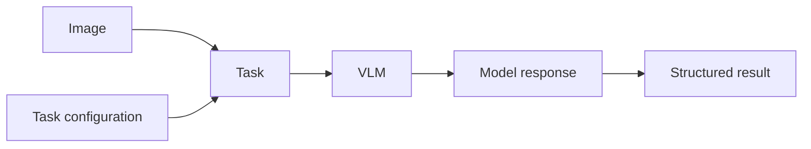

# VLM tasks

[](pyproject.toml)
[](pyproject.toml)
[](LICENSE)

VLM tasks is a thin interface that coerces **vision-language models
(VLMs)** into producing structured results for tasks such as classification,
detection, grounding and attribute prediction.

Choose a task, provide the minimum information it needs, such as labels or a
target description, and add optional context. The framework handles prompting
and enforces the task's output structure, returning a Python result you can use
in your application.

Built-in validation helps you measure prediction quality on labeled datasets
and compare models on your own data.

## Use cases

Use VLM tasks alongside models such as YOLO, DETR, SAM, and Florence to add
structured decisions defined by your labels, attributes, and context:

- **Enrich traditional CV model outputs:** use a pretrained VLM's visual and
  language knowledge to add information such as descriptions or attributes to
  your detections.
- **Extend beyond model vocabulary:** express targets, relationships, and
  task criteria in natural language, and generate outputs or descriptions beyond
  an existing CV model's trained vocabulary.
- **Support novel classes and labels:** use VLMs' pretrained weights to work with
  new classes or labels without additional training.
- **Common VLM tasks:** leverage the structured output to
  integrate VLMs into your applications or pipelines.

## Quick start

### Install

Requires Python 3.11+. Install from a local checkout:

```bash
python -m pip install -e .
```

### Connect your model

Choose one of the options below to create a `backend`, then pass it to a task.

#### Hugging Face Transformers

Run a model locally with Transformers. Install the dependencies for this option:

```bash
python -m pip install 'torch>=2.5' torchvision 'transformers>=4.57,<5' 'Pillow>=10'
```

The first run downloads the model weights; inference runs on your machine.

```python
from transformers import AutoModelForImageTextToText, AutoProcessor

from ml_pipes.vlm import PydanticAIBackend, TransformersModel

model_id = "Qwen/Qwen3-VL-2B-Instruct"
processor = AutoProcessor.from_pretrained(model_id)
weights = AutoModelForImageTextToText.from_pretrained(model_id)
backend = PydanticAIBackend(
    TransformersModel(weights, processor, model_name=model_id),
)
```

See the [Transformers guide](docs/huggingface-transformers.md) for device
setup and other checkpoints.

#### vLLM and other providers

Connect to a vision-language model already running on a vLLM server. Install the
client dependencies:

```bash
python -m pip install 'pydantic-ai-slim[openai]==2.61.0'
```

```python
from pydantic_ai.models.openai import OpenAIChatModel
from pydantic_ai.providers.vllm import VLLMProvider

from ml_pipes.vlm import PydanticAIBackend

backend = PydanticAIBackend(OpenAIChatModel(
    "Qwen/Qwen3-VL-2B-Instruct",  # Replace with your server's model name.
    provider=VLLMProvider(base_url="http://localhost:8000/v1"),
))
```

You can also wrap an existing PydanticAI model with `PydanticAIBackend(model)`.
See the [model backend guide](docs/model-backends.md) for other providers.

### Run a task

Pass your `backend` to a task and specify what to predict. For example, describe
a chair's material and condition:

```python
import ml_pipes.vlm as tasks

task = tasks.Attributes(
    backend,
    attributes={
        "material": ["wood", "metal", "plastic"],
        "condition": ["clean", "dirty"],
    },
    context="Describe the chair in the image.",
)
result = task("chair.jpg")

print(result.attributes)
```

**Structured result:** each requested attribute maps to exactly one allowed
value. Example output:

```text
{'material': 'wood', 'condition': 'clean'}
```

Access individual values with `result.attributes["material"]`.

See [available tasks](#available-tasks) for the full list and the
[API reference](docs/reference.md#operators) for task options.

### Built-in validation

A model can produce the right response format and still make the wrong
prediction. Use built-in validation to measure accuracy on a dataset that is
downloaded and prepared automatically. For attributes, OVAD supplies the
benchmark's attribute choices:

```python
metrics = tasks.Attributes(backend).val(max_samples=10)
print(metrics.results_dict)  # Accuracy and failure statistics.
```

**Example result:** a local `Attributes` run with `Qwen/Qwen3-VL-2B-Instruct` on
the first 100 eligible OVAD objects (17 images), using Apple MPS and float16:

| Metric | Result |
|---|---:|
| Attribute accuracy | 58.52% (450 / 769 decisions) |
| Mean attribute accuracy | 59.12% |
| Macro F1 | 45.69% |
| Inference failures | 1 / 100 |

These results describe a small ordered subset using categorical attribute
scoring. See the [attribute validation guide](docs/validation.md#attributes-ovad-object-crops)
for details.

### Validate on your own data

```python
metrics = tasks.Attributes(backend).val(data="./annotations.json", images="./images")
```

See the [custom dataset guide](docs/validation.md#using-your-own-dataset) for
supported formats and setup.

## How tasks work



The framework builds the model instructions from your task settings and
context, then checks and converts the response into a structured result.

## Available tasks

| Task | What it does | Status |
|---|---|---|
| `Classify` | Choose exactly one label, such as cat or dog. | Available |
| `ClassifyMultiLabel` | Choose all applicable labels, such as scratched and stained. | Available |
| `Detect` | Find matching objects and return labeled bounding boxes. | Available |
| `Ground` | Locate a described target, such as “the leftmost cat,” as a box or point. | Available |
| `Attributes` | Predict named properties, such as material and condition, from allowed choices. | Available |
| `Caption` | Describe an image in natural language. | Planned |
| `Answer` | Answer a question about an image. | Planned |
| `ReadText` | Read text visible in an image (OCR). | Planned |

Planned tasks are the next additions; they are not available yet. For task
options and result types, see the [API reference](docs/reference.md). For the
broader roadmap, see the [task catalog](docs/design.md#task-catalog).
