# VLM benchmarks: by model and task

Generated by `python -m benchmarks.src.generate_report`. [Methodology](methodology.md) · [Code](src/) · [CSV](reports/metrics.csv) · [Table fields](#table-field-guide)

Main validation metric per task; **best observed values** are bold. Failures are included. Caption ROUGE-L uses its native scale; other values are percentages. Select a model or task name for detailed metrics and usage.

| Task | Main metric | [Qwen3-VL-2B](#qwen3-vl-2b) | [Gemma 3 27B](#gemma-3-27b) | [Kimi K3.1](#kimi-k31) | [Qwen3-VL-235B](#qwen3-vl-235b) |
|---|---|---:|---:|---:|---:|
| [Classification](#classification) | Top-1 Acc | 93% | 82% | 67% | **96%** |
| [Detection](#detection) | F1@0.5 | 11.24% | 8.27% | **63.75%** | 16.67% |
| [Grounding (Box)](#box) | Acc@0.5 | 22% | 16% | **92%** | 31% |
| [Grounding (Point)](#point) | Point-in-box Acc | 35% | 53% | **98%** | 41% |
| [Attributes](#attributes) | Acc | 55.27% | 70.22% | **75.68%** | 73.86% |
| [VQA](#vqa) | VQA Acc | 65% | 56% | 42.7% | **68.4%** |
| [Captioning](#captioning) | ROUGE-L | 0.3017 | **0.4274** | 0.3301 | 0.3841 |

## Model profiles

**Model view:** each radar chart summarizes one model across the benchmark tasks, showing its strengths and weaknesses. Select a chart or expand a model below for full metrics, usage, cost and latency.

<table>
  <tr>
    <td width="25%" align="center">
      <a href="#qwen3-vl-2b"><strong>Qwen3-VL-2B</strong></a> 
      <a href="#qwen3-vl-2b">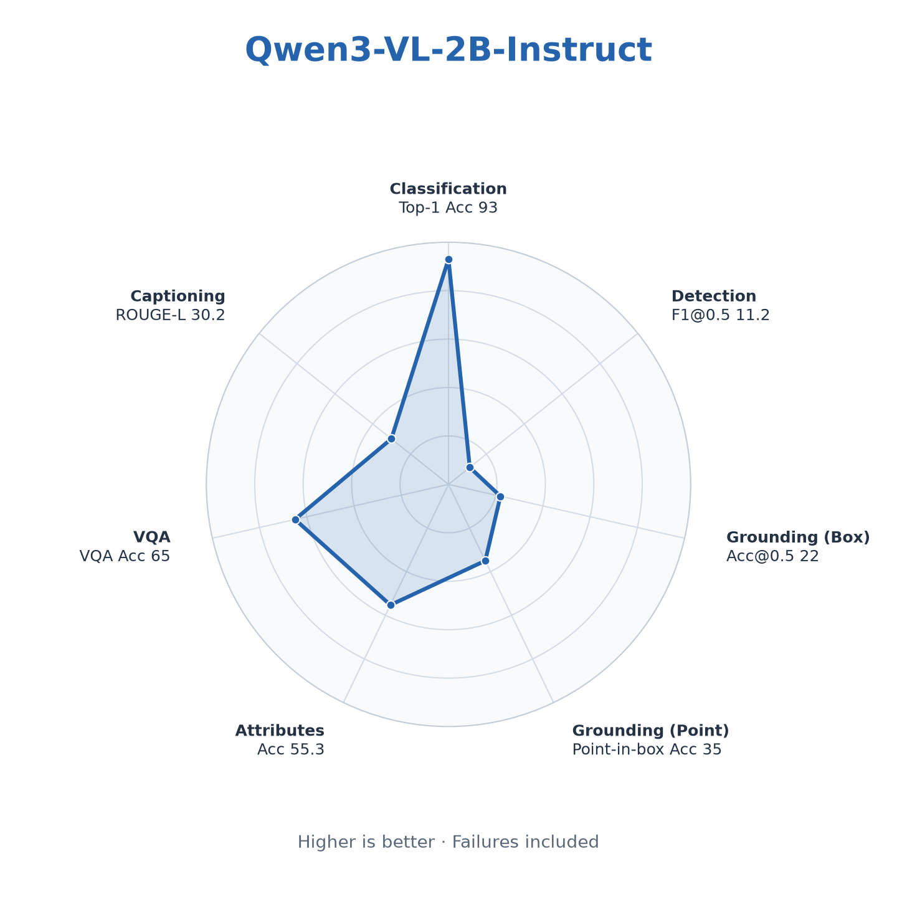</a> 
      <a href="reports/charts/model-profiles/qwen3-vl-2b-20261112.png">PNG</a> · <a href="reports/charts/model-profiles/qwen3-vl-2b-20261112.svg">SVG</a>
    </td>
    <td width="25%" align="center">
      <a href="#gemma-3-27b"><strong>Gemma 3 27B</strong></a> 
      <a href="#gemma-3-27b">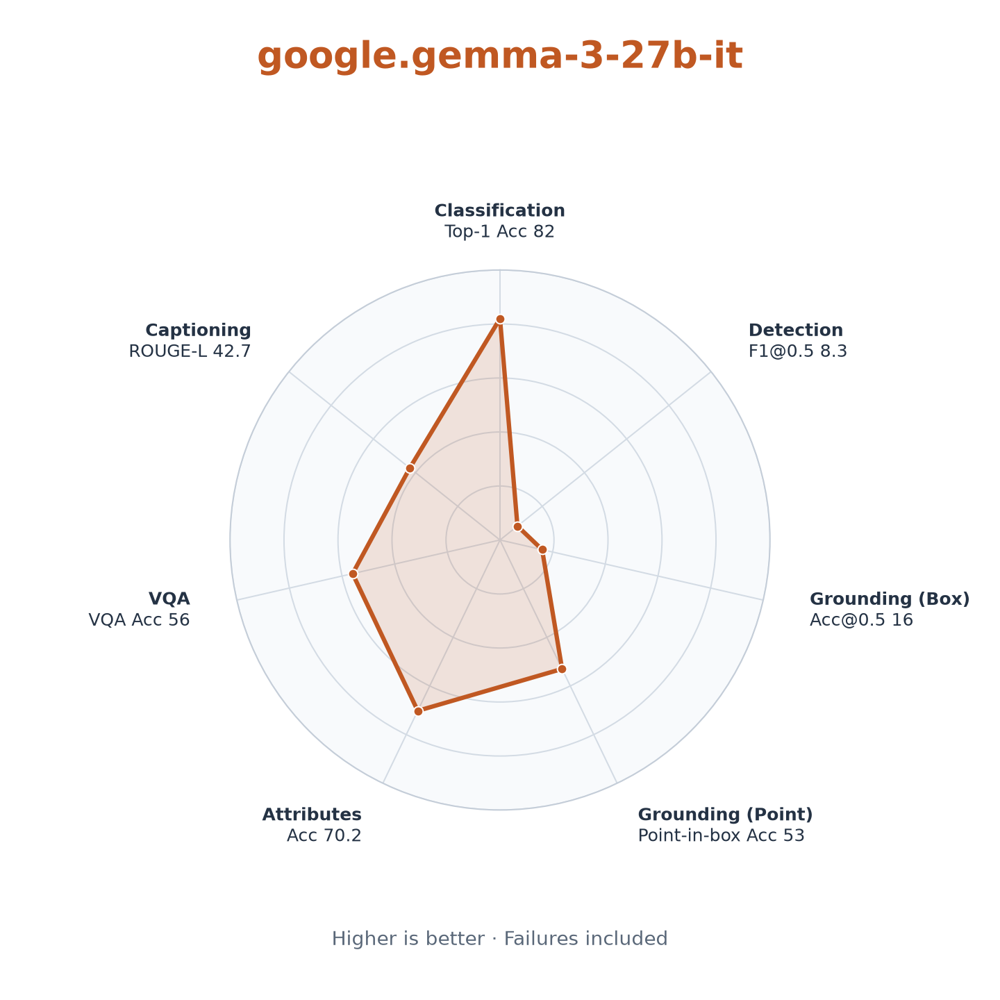</a> 
      <a href="reports/charts/model-profiles/gemma3-27b-bedrock-20261112.png">PNG</a> · <a href="reports/charts/model-profiles/gemma3-27b-bedrock-20261112.svg">SVG</a>
    </td>
    <td width="25%" align="center">
      <a href="#kimi-k31"><strong>Kimi K3.1</strong></a> 
      <a href="#kimi-k31">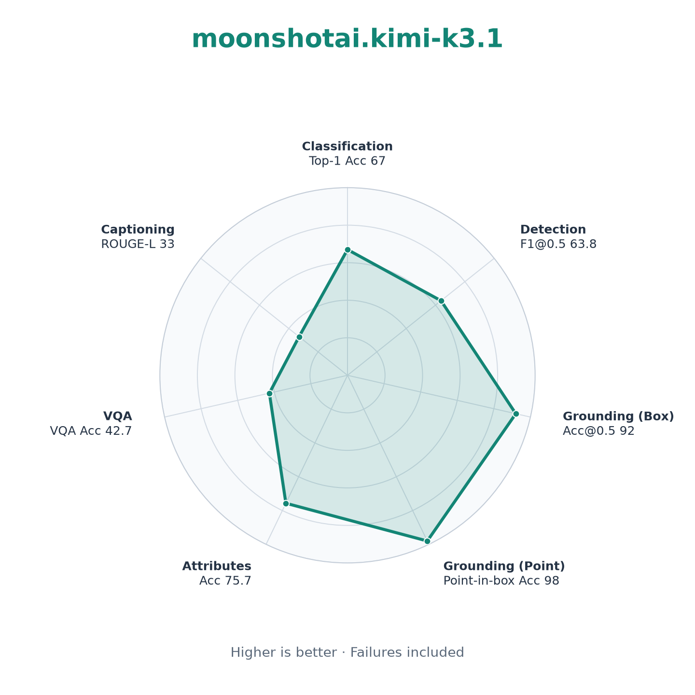</a> 
      <a href="reports/charts/model-profiles/kimi-k3.1-bedrock-20261112.png">PNG</a> · <a href="reports/charts/model-profiles/kimi-k3.1-bedrock-20261112.svg">SVG</a>
    </td>
    <td width="25%" align="center">
      <a href="#qwen3-vl-235b"><strong>Qwen3-VL-235B</strong></a> 
      <a href="#qwen3-vl-235b">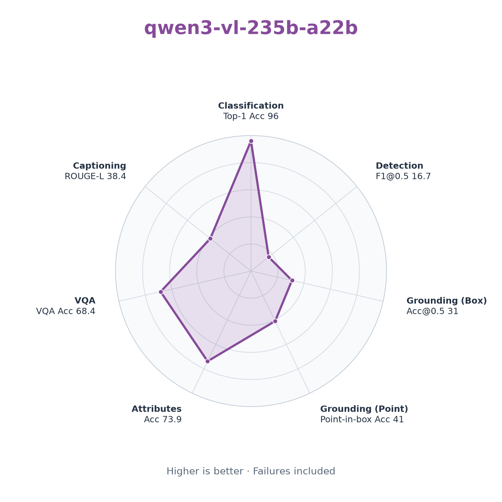</a> 
      <a href="reports/charts/model-profiles/qwen3-vl-235b-bedrock-20261112.png">PNG</a> · <a href="reports/charts/model-profiles/qwen3-vl-235b-bedrock-20261112.svg">SVG</a>
    </td>
  </tr>
</table>

All profiles use the same axes and scale; higher is better. Failures are included. Polygon area is not an overall score. [Chart method](methodology.md#model-profile-charts)

### Qwen3-VL-2B

View chart, metrics and usage

| Model | Task / dataset | N | Validation metrics | Failure rate (at cap) | Input tokens / sample | Output tokens / sample | Estimated cost / 1,000 samples | Mean latency (s) |
|---|---|---:|---|---:|---:|---:|---:|---:|
| Qwen/Qwen3-VL-2B-Instruct | [classify / cifar10](runs/qwen3-vl-2b-20261112/classify.json) | 100 | Top-1 Acc 93% | 0% (0%) | 332 | 7 | — | 0.705 |
| Qwen/Qwen3-VL-2B-Instruct | [detect / coco128](runs/qwen3-vl-2b-20261112/detect.json) | 100 | P@0.5 33.56%; R@0.5 6.75%; F1@0.5 11.24% | 21% (13%) | 1,394 | 661 | — | 30.166 |
| Qwen/Qwen3-VL-2B-Instruct | [ground_box / refcocog](runs/qwen3-vl-2b-20261112/ground_box.json) | 100 | Acc@0.5 22%; Acc@0.75 2%; Acc@0.9 0%; Mean IoU 28.04% | 2% (0%) | 684 | 48 | — | 2.794 |
| Qwen/Qwen3-VL-2B-Instruct | [ground_point / refcocog](runs/qwen3-vl-2b-20261112/ground_point.json) | 100 | Point-in-box Acc 35% | 0% (0%) | 648 | 28 | — | 1.986 |
| Qwen/Qwen3-VL-2B-Instruct | [attributes / ovad](runs/qwen3-vl-2b-20261112/attributes.json) | 100 | Acc 55.27%; Mean Acc 58.45%; Macro F1 46.93% | 1% (0%) | 1,602 | 152 | — | 7.82 |
| Qwen/Qwen3-VL-2B-Instruct | [answer / vqav2](runs/qwen3-vl-2b-20261112/answer.json) | 100 | VQA Acc 65% | 0% (0%) | 572 | 14 | — | 1.432 |
| Qwen/Qwen3-VL-2B-Instruct | [describe / coco_captions2017](runs/qwen3-vl-2b-20261112/describe.json) | 100 | CIDEr 0.0355; BLEU-1 0.2861; BLEU-2 0.1889; BLEU-3 0.1155; BLEU-4 0.069; ROUGE-L 0.3017 | 0% (0%) | 452 | 66 | — | 3.272 |

### Gemma 3 27B

View chart, metrics and usage

| Model | Task / dataset | N | Validation metrics | Failure rate (at cap) | Input tokens / sample | Output tokens / sample | Estimated cost / 1,000 samples | Mean latency (s) |
|---|---|---:|---|---:|---:|---:|---:|---:|
| google.gemma-3-27b-it | [classify / cifar10](runs/gemma3-27b-bedrock-20261112/classify.json) | 100 | Top-1 Acc 82% | 0% (0%) | 523 | 7 | 0.123 | 0.907 |
| google.gemma-3-27b-it | [detect / coco128](runs/gemma3-27b-bedrock-20261112/detect.json) | 100 | P@0.5 11.43%; R@0.5 6.48%; F1@0.5 8.27% | 2% (0%) | 1,301 | 297 | 0.412 | 7.009 |
| google.gemma-3-27b-it | [ground_box / refcocog](runs/gemma3-27b-bedrock-20261112/ground_box.json) | 100 | Acc@0.5 16%; Acc@0.75 0%; Acc@0.9 0%; Mean IoU 23.97% | 0% (0%) | 695 | 52 | 0.18 | 2.091 |
| google.gemma-3-27b-it | [ground_point / refcocog](runs/gemma3-27b-bedrock-20261112/ground_point.json) | 100 | Point-in-box Acc 53% | 0% (0%) | 660 | 31 | 0.164 | 1.715 |
| google.gemma-3-27b-it | [attributes / ovad](runs/gemma3-27b-bedrock-20261112/attributes.json) | 100 | Acc 70.22%; Mean Acc 69.47%; Macro F1 53.78% | 1% (0%) | 1,726 | 206 | 0.475 | 4.527 |
| google.gemma-3-27b-it | [answer / vqav2](runs/gemma3-27b-bedrock-20261112/answer.json) | 100 | VQA Acc 56% | 0% (0%) | 537 | 16 | 0.13 | 1.288 |
| google.gemma-3-27b-it | [describe / coco_captions2017](runs/gemma3-27b-bedrock-20261112/describe.json) | 100 | CIDEr 0.3408; BLEU-1 0.5041; BLEU-2 0.3213; BLEU-3 0.1994; BLEU-4 0.1179; ROUGE-L 0.4274 | 0% (0%) | 443 | 30 | 0.113 | 1.569 |

### Kimi K3.1

View chart, metrics and usage

| Model | Task / dataset | N | Validation metrics | Failure rate (at cap) | Input tokens / sample | Output tokens / sample | Estimated cost / 1,000 samples | Mean latency (s) |
|---|---|---:|---|---:|---:|---:|---:|---:|
| moonshotai.kimi-k3.1 | [classify / cifar10](runs/kimi-k3.1-bedrock-20261112/classify.json) | 100 | Top-1 Acc 67% | 0% (0%) | 364 | 745 | 16.363 | 7.852 |
| moonshotai.kimi-k3.1 | [detect / coco128](runs/kimi-k3.1-bedrock-20261112/detect.json) | 100 | P@0.5 70.72%; R@0.5 58.03%; F1@0.5 63.75% | 1% (1%) | 1,598 | 2,366 | 51.028 | 20.167 |
| moonshotai.kimi-k3.1 | [ground_box / refcocog](runs/kimi-k3.1-bedrock-20261112/ground_box.json) | 100 | Acc@0.5 92%; Acc@0.75 78%; Acc@0.9 55%; Mean IoU 82.51% | 0% (0%) | 866 | 960 | 21.232 | 9.909 |
| moonshotai.kimi-k3.1 | [ground_point / refcocog](runs/kimi-k3.1-bedrock-20261112/ground_point.json) | 100 | Point-in-box Acc 98% | 0% (0%) | 830 | 665 | 15.454 | 7.589 |
| moonshotai.kimi-k3.1 | [attributes / ovad](runs/kimi-k3.1-bedrock-20261112/attributes.json) | 100 | Acc 75.68%; Mean Acc 76.79%; Macro F1 58.72% | 0% (0%) | 1,655 | 2,238 | 47.504 | 18.575 |
| moonshotai.kimi-k3.1 | [answer / vqav2](runs/kimi-k3.1-bedrock-20261112/answer.json) | 100 | VQA Acc 42.7% | 0% (0%) | 769 | 277 | 8.617 | 4.611 |
| moonshotai.kimi-k3.1 | [describe / coco_captions2017](runs/kimi-k3.1-bedrock-20261112/describe.json) | 100 | CIDEr 0.0375; BLEU-1 0.3712; BLEU-2 0.2074; BLEU-3 0.1116; BLEU-4 0.0574; ROUGE-L 0.3301 | 0% (0%) | 644 | 237 | 7.318 | 4.372 |

### Qwen3-VL-235B

View chart, metrics and usage

| Model | Task / dataset | N | Validation metrics | Failure rate (at cap) | Input tokens / sample | Output tokens / sample | Estimated cost / 1,000 samples | Mean latency (s) |
|---|---|---:|---|---:|---:|---:|---:|---:|
| qwen.qwen3-vl-235b-a22b | [classify / cifar10](runs/qwen3-vl-235b-bedrock-20261112/classify.json) | 100 | Top-1 Acc 96% | 0% (0%) | 332 | 7 | 0.195 | 0.519 |
| qwen.qwen3-vl-235b-a22b | [detect / coco128](runs/qwen3-vl-235b-bedrock-20261112/detect.json) | 100 | P@0.5 90.67%; R@0.5 9.18%; F1@0.5 16.67% | 26% (1%) | 1,394 | 162 | 1.169 | 2.915 |
| qwen.qwen3-vl-235b-a22b | [ground_box / refcocog](runs/qwen3-vl-235b-bedrock-20261112/ground_box.json) | 100 | Acc@0.5 31%; Acc@0.75 29%; Acc@0.9 14%; Mean IoU 28.13% | 53% (0%) | 684 | 41 | 0.471 | 1.13 |
| qwen.qwen3-vl-235b-a22b | [ground_point / refcocog](runs/qwen3-vl-235b-bedrock-20261112/ground_point.json) | 100 | Point-in-box Acc 41% | 50% (0%) | 648 | 26 | 0.412 | 1.032 |
| qwen.qwen3-vl-235b-a22b | [attributes / ovad](runs/qwen3-vl-235b-bedrock-20261112/attributes.json) | 100 | Acc 73.86%; Mean Acc 72.45%; Macro F1 56.55% | 5% (0%) | 1,602 | 168 | 1.297 | 2.681 |
| qwen.qwen3-vl-235b-a22b | [answer / vqav2](runs/qwen3-vl-235b-bedrock-20261112/answer.json) | 100 | VQA Acc 68.4% | 0% (0%) | 572 | 14 | 0.34 | 0.785 |
| qwen.qwen3-vl-235b-a22b | [describe / coco_captions2017](runs/qwen3-vl-235b-bedrock-20261112/describe.json) | 100 | CIDEr 0.0995; BLEU-1 0.4305; BLEU-2 0.2745; BLEU-3 0.1676; BLEU-4 0.0958; ROUGE-L 0.3841 | 0% (0%) | 452 | 39 | 0.342 | 1.023 |

## Task comparisons

**Task view:** each bar chart compares models on the same task using its main validation metric. Select a chart or expand a task below for all metrics, usage, cost and latency.

<table>
  <tr>
    <td width="25%" align="center">
      <a href="#classification"><strong>Classification</strong></a> 
      <a href="#classification">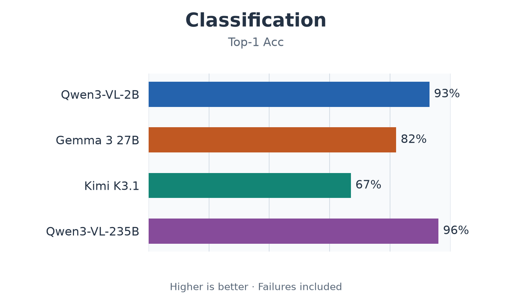</a> 
      <a href="reports/charts/task-comparisons/classify.png">PNG</a> · <a href="reports/charts/task-comparisons/classify.svg">SVG</a>
    </td>
    <td width="25%" align="center">
      <a href="#detection"><strong>Detection</strong></a> 
      <a href="#detection">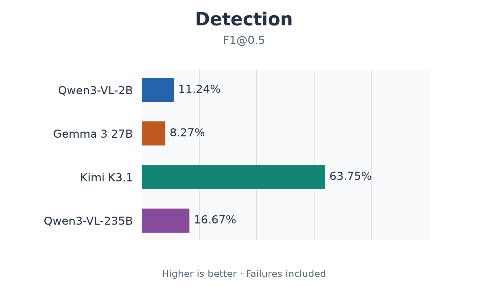</a> 
      <a href="reports/charts/task-comparisons/detect.png">PNG</a> · <a href="reports/charts/task-comparisons/detect.svg">SVG</a>
    </td>
    <td width="25%" align="center">
      <a href="#box"><strong>Grounding (Box)</strong></a> 
      <a href="#box">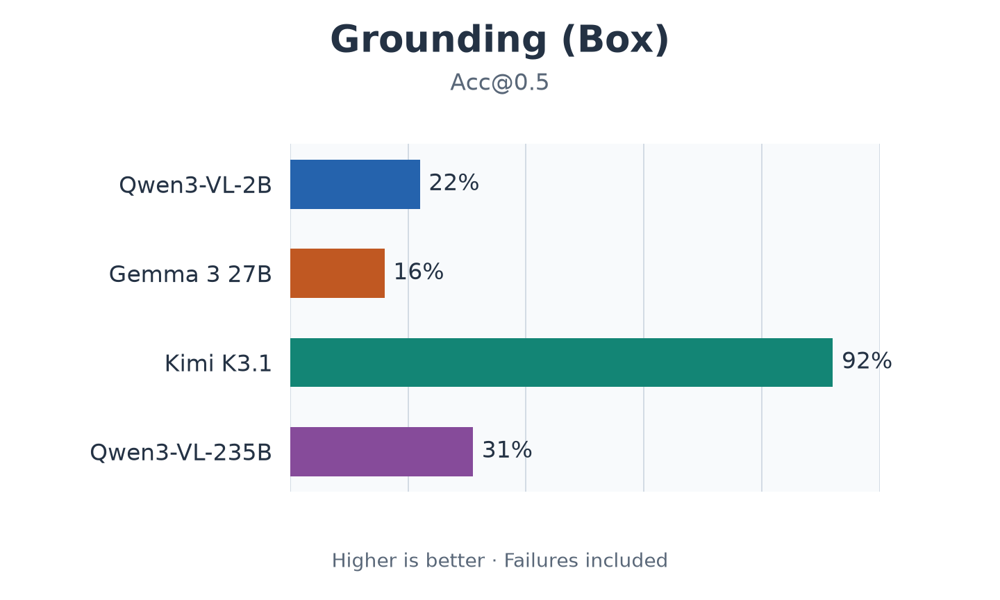</a> 
      <a href="reports/charts/task-comparisons/ground_box.png">PNG</a> · <a href="reports/charts/task-comparisons/ground_box.svg">SVG</a>
    </td>
    <td width="25%" align="center">
      <a href="#point"><strong>Grounding (Point)</strong></a> 
      <a href="#point">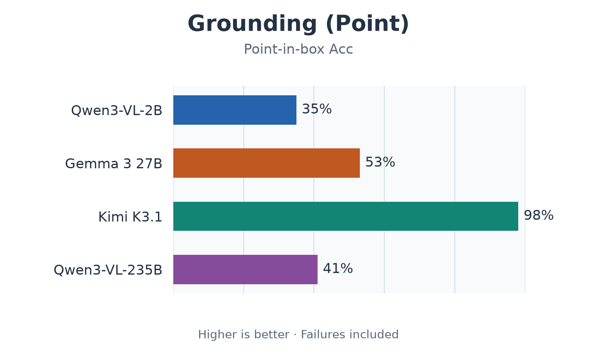</a> 
      <a href="reports/charts/task-comparisons/ground_point.png">PNG</a> · <a href="reports/charts/task-comparisons/ground_point.svg">SVG</a>
    </td>
  </tr>
  <tr>
    <td width="25%" align="center">
      <a href="#attributes"><strong>Attributes</strong></a> 
      <a href="#attributes">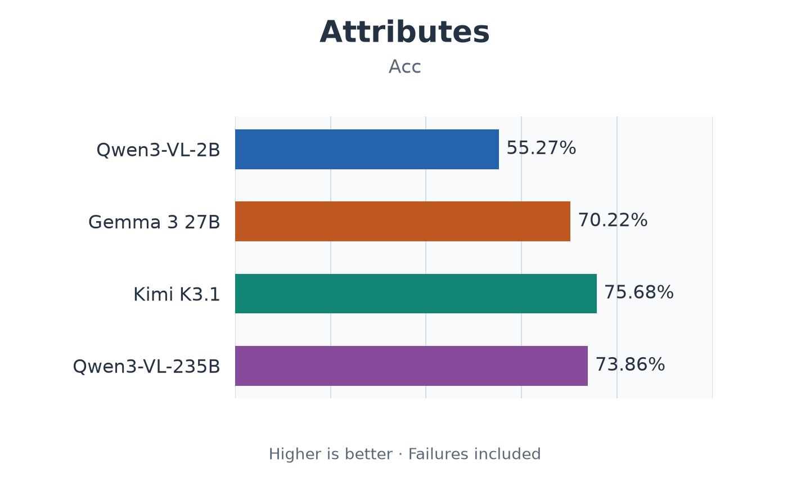</a> 
      <a href="reports/charts/task-comparisons/attributes.png">PNG</a> · <a href="reports/charts/task-comparisons/attributes.svg">SVG</a>
    </td>
    <td width="25%" align="center">
      <a href="#vqa"><strong>VQA</strong></a> 
      <a href="#vqa">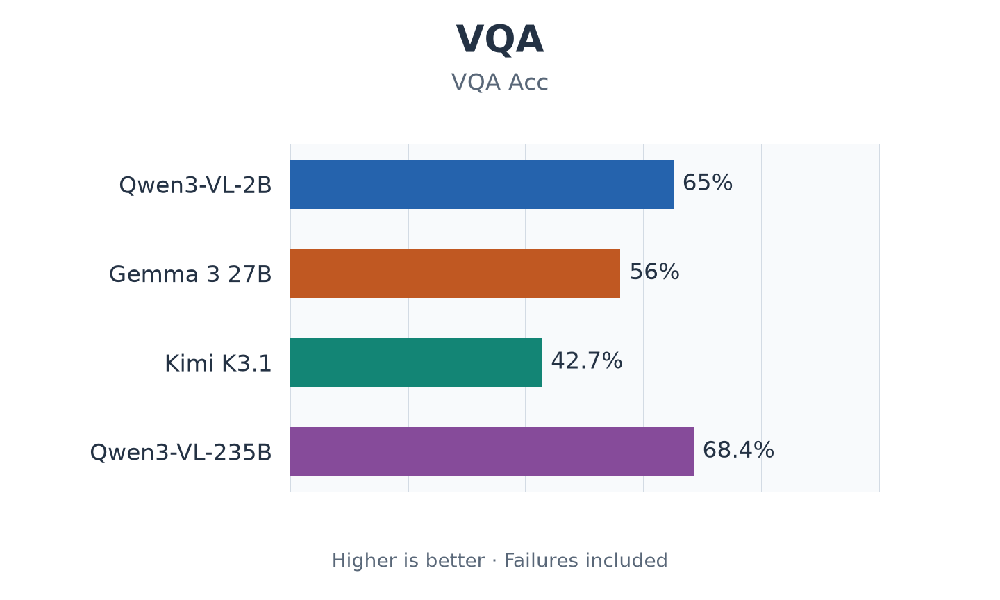</a> 
      <a href="reports/charts/task-comparisons/answer.png">PNG</a> · <a href="reports/charts/task-comparisons/answer.svg">SVG</a>
    </td>
    <td width="25%" align="center">
      <a href="#captioning"><strong>Captioning</strong></a> 
      <a href="#captioning">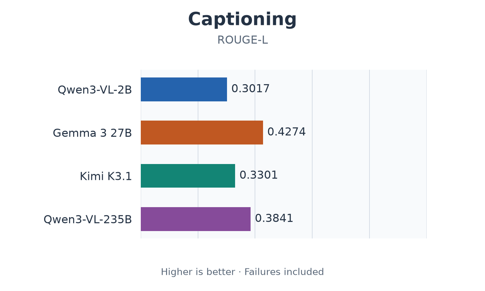</a> 
      <a href="reports/charts/task-comparisons/describe.png">PNG</a> · <a href="reports/charts/task-comparisons/describe.svg">SVG</a>
    </td>
    <td width="25%"></td>
  </tr>
</table>

### Classification

View chart, metrics and usage

| Model | Task / dataset | N | Validation metrics | Failure rate (at cap) | Input tokens / sample | Output tokens / sample | Estimated cost / 1,000 samples | Mean latency (s) |
|---|---|---:|---|---:|---:|---:|---:|---:|
| Qwen/Qwen3-VL-2B-Instruct | [classify / cifar10](runs/qwen3-vl-2b-20261112/classify.json) | 100 | Top-1 Acc 93% | 0% (0%) | 332 | 7 | — | 0.705 |
| google.gemma-3-27b-it | [classify / cifar10](runs/gemma3-27b-bedrock-20261112/classify.json) | 100 | Top-1 Acc 82% | 0% (0%) | 523 | 7 | 0.123 | 0.907 |
| moonshotai.kimi-k3.1 | [classify / cifar10](runs/kimi-k3.1-bedrock-20261112/classify.json) | 100 | Top-1 Acc 67% | 0% (0%) | 364 | 745 | 16.363 | 7.852 |
| qwen.qwen3-vl-235b-a22b | [classify / cifar10](runs/qwen3-vl-235b-bedrock-20261112/classify.json) | 100 | Top-1 Acc 96% | 0% (0%) | 332 | 7 | 0.195 | 0.519 |

### Detection

View chart, metrics and usage

| Model | Task / dataset | N | Validation metrics | Failure rate (at cap) | Input tokens / sample | Output tokens / sample | Estimated cost / 1,000 samples | Mean latency (s) |
|---|---|---:|---|---:|---:|---:|---:|---:|
| Qwen/Qwen3-VL-2B-Instruct | [detect / coco128](runs/qwen3-vl-2b-20261112/detect.json) | 100 | P@0.5 33.56%; R@0.5 6.75%; F1@0.5 11.24% | 21% (13%) | 1,394 | 661 | — | 30.166 |
| google.gemma-3-27b-it | [detect / coco128](runs/gemma3-27b-bedrock-20261112/detect.json) | 100 | P@0.5 11.43%; R@0.5 6.48%; F1@0.5 8.27% | 2% (0%) | 1,301 | 297 | 0.412 | 7.009 |
| moonshotai.kimi-k3.1 | [detect / coco128](runs/kimi-k3.1-bedrock-20261112/detect.json) | 100 | P@0.5 70.72%; R@0.5 58.03%; F1@0.5 63.75% | 1% (1%) | 1,598 | 2,366 | 51.028 | 20.167 |
| qwen.qwen3-vl-235b-a22b | [detect / coco128](runs/qwen3-vl-235b-bedrock-20261112/detect.json) | 100 | P@0.5 90.67%; R@0.5 9.18%; F1@0.5 16.67% | 26% (1%) | 1,394 | 162 | 1.169 | 2.915 |

### Grounding

View variations

#### Box

View chart, metrics and usage

| Model | Task / dataset | N | Validation metrics | Failure rate (at cap) | Input tokens / sample | Output tokens / sample | Estimated cost / 1,000 samples | Mean latency (s) |
|---|---|---:|---|---:|---:|---:|---:|---:|
| Qwen/Qwen3-VL-2B-Instruct | [ground_box / refcocog](runs/qwen3-vl-2b-20261112/ground_box.json) | 100 | Acc@0.5 22%; Acc@0.75 2%; Acc@0.9 0%; Mean IoU 28.04% | 2% (0%) | 684 | 48 | — | 2.794 |
| google.gemma-3-27b-it | [ground_box / refcocog](runs/gemma3-27b-bedrock-20261112/ground_box.json) | 100 | Acc@0.5 16%; Acc@0.75 0%; Acc@0.9 0%; Mean IoU 23.97% | 0% (0%) | 695 | 52 | 0.18 | 2.091 |
| moonshotai.kimi-k3.1 | [ground_box / refcocog](runs/kimi-k3.1-bedrock-20261112/ground_box.json) | 100 | Acc@0.5 92%; Acc@0.75 78%; Acc@0.9 55%; Mean IoU 82.51% | 0% (0%) | 866 | 960 | 21.232 | 9.909 |
| qwen.qwen3-vl-235b-a22b | [ground_box / refcocog](runs/qwen3-vl-235b-bedrock-20261112/ground_box.json) | 100 | Acc@0.5 31%; Acc@0.75 29%; Acc@0.9 14%; Mean IoU 28.13% | 53% (0%) | 684 | 41 | 0.471 | 1.13 |

#### Point

View chart, metrics and usage

| Model | Task / dataset | N | Validation metrics | Failure rate (at cap) | Input tokens / sample | Output tokens / sample | Estimated cost / 1,000 samples | Mean latency (s) |
|---|---|---:|---|---:|---:|---:|---:|---:|
| Qwen/Qwen3-VL-2B-Instruct | [ground_point / refcocog](runs/qwen3-vl-2b-20261112/ground_point.json) | 100 | Point-in-box Acc 35% | 0% (0%) | 648 | 28 | — | 1.986 |
| google.gemma-3-27b-it | [ground_point / refcocog](runs/gemma3-27b-bedrock-20261112/ground_point.json) | 100 | Point-in-box Acc 53% | 0% (0%) | 660 | 31 | 0.164 | 1.715 |
| moonshotai.kimi-k3.1 | [ground_point / refcocog](runs/kimi-k3.1-bedrock-20261112/ground_point.json) | 100 | Point-in-box Acc 98% | 0% (0%) | 830 | 665 | 15.454 | 7.589 |
| qwen.qwen3-vl-235b-a22b | [ground_point / refcocog](runs/qwen3-vl-235b-bedrock-20261112/ground_point.json) | 100 | Point-in-box Acc 41% | 50% (0%) | 648 | 26 | 0.412 | 1.032 |

### Attributes

View chart, metrics and usage

| Model | Task / dataset | N | Validation metrics | Failure rate (at cap) | Input tokens / sample | Output tokens / sample | Estimated cost / 1,000 samples | Mean latency (s) |
|---|---|---:|---|---:|---:|---:|---:|---:|
| Qwen/Qwen3-VL-2B-Instruct | [attributes / ovad](runs/qwen3-vl-2b-20261112/attributes.json) | 100 | Acc 55.27%; Mean Acc 58.45%; Macro F1 46.93% | 1% (0%) | 1,602 | 152 | — | 7.82 |
| google.gemma-3-27b-it | [attributes / ovad](runs/gemma3-27b-bedrock-20261112/attributes.json) | 100 | Acc 70.22%; Mean Acc 69.47%; Macro F1 53.78% | 1% (0%) | 1,726 | 206 | 0.475 | 4.527 |
| moonshotai.kimi-k3.1 | [attributes / ovad](runs/kimi-k3.1-bedrock-20261112/attributes.json) | 100 | Acc 75.68%; Mean Acc 76.79%; Macro F1 58.72% | 0% (0%) | 1,655 | 2,238 | 47.504 | 18.575 |
| qwen.qwen3-vl-235b-a22b | [attributes / ovad](runs/qwen3-vl-235b-bedrock-20261112/attributes.json) | 100 | Acc 73.86%; Mean Acc 72.45%; Macro F1 56.55% | 5% (0%) | 1,602 | 168 | 1.297 | 2.681 |

### VQA

View chart, metrics and usage

| Model | Task / dataset | N | Validation metrics | Failure rate (at cap) | Input tokens / sample | Output tokens / sample | Estimated cost / 1,000 samples | Mean latency (s) |
|---|---|---:|---|---:|---:|---:|---:|---:|
| Qwen/Qwen3-VL-2B-Instruct | [answer / vqav2](runs/qwen3-vl-2b-20261112/answer.json) | 100 | VQA Acc 65% | 0% (0%) | 572 | 14 | — | 1.432 |
| google.gemma-3-27b-it | [answer / vqav2](runs/gemma3-27b-bedrock-20261112/answer.json) | 100 | VQA Acc 56% | 0% (0%) | 537 | 16 | 0.13 | 1.288 |
| moonshotai.kimi-k3.1 | [answer / vqav2](runs/kimi-k3.1-bedrock-20261112/answer.json) | 100 | VQA Acc 42.7% | 0% (0%) | 769 | 277 | 8.617 | 4.611 |
| qwen.qwen3-vl-235b-a22b | [answer / vqav2](runs/qwen3-vl-235b-bedrock-20261112/answer.json) | 100 | VQA Acc 68.4% | 0% (0%) | 572 | 14 | 0.34 | 0.785 |

### Captioning

View chart, metrics and usage

| Model | Task / dataset | N | Validation metrics | Failure rate (at cap) | Input tokens / sample | Output tokens / sample | Estimated cost / 1,000 samples | Mean latency (s) |
|---|---|---:|---|---:|---:|---:|---:|---:|
| Qwen/Qwen3-VL-2B-Instruct | [describe / coco_captions2017](runs/qwen3-vl-2b-20261112/describe.json) | 100 | CIDEr 0.0355; BLEU-1 0.2861; BLEU-2 0.1889; BLEU-3 0.1155; BLEU-4 0.069; ROUGE-L 0.3017 | 0% (0%) | 452 | 66 | — | 3.272 |
| google.gemma-3-27b-it | [describe / coco_captions2017](runs/gemma3-27b-bedrock-20261112/describe.json) | 100 | CIDEr 0.3408; BLEU-1 0.5041; BLEU-2 0.3213; BLEU-3 0.1994; BLEU-4 0.1179; ROUGE-L 0.4274 | 0% (0%) | 443 | 30 | 0.113 | 1.569 |
| moonshotai.kimi-k3.1 | [describe / coco_captions2017](runs/kimi-k3.1-bedrock-20261112/describe.json) | 100 | CIDEr 0.0375; BLEU-1 0.3712; BLEU-2 0.2074; BLEU-3 0.1116; BLEU-4 0.0574; ROUGE-L 0.3301 | 0% (0%) | 644 | 237 | 7.318 | 4.372 |
| qwen.qwen3-vl-235b-a22b | [describe / coco_captions2017](runs/qwen3-vl-235b-bedrock-20261112/describe.json) | 100 | CIDEr 0.0995; BLEU-1 0.4305; BLEU-2 0.2745; BLEU-3 0.1676; BLEU-4 0.0958; ROUGE-L 0.3841 | 0% (0%) | 452 | 39 | 0.342 | 1.023 |

## Table field guide

- **Model**: the evaluated model identifier; model columns in the overview identify the same runs. Their headings link to model details. Hardware, provider settings and regions are recorded in the run metadata and can affect comparisons.

- **Task / dataset**, **Task**: the task, its variation and evaluation data. Detail-table links open saved reports; overview task names open the matching task details. Classification uses CIFAR-10 test (`val` alias), detection uses COCO128 training images, and OVAD uses its benchmark (`val` alias). Grounding, VQA and captions use validation splits. `ClassifyMultiLabel` has no built-in validation dataset and is excluded.

- **N**: the number of evaluated samples, including failures. Token means, cost projections, failure rates and cap rates use this count. Samples can share images.

- **Validation metrics**, **Main metric**: task quality scores from the validators. Main metric selects the score used in the overview and charts. Higher is better; ratios are percentages and caption scores use their native scale. `Acc` means accuracy: `Top-1 Acc` measures classification, `Mean Acc` averages attribute-group accuracies, `VQA Acc` uses answer consensus, and `Point-in-box Acc` counts predicted points inside target boxes. For Grounding (Box), `Acc@0.5`, `Acc@0.75` and `Acc@0.9` require IoU ≥ the indicated threshold. Detection's `P`, `R` and `F1` use the indicated IoU matching threshold. Bold overview values mark the best observed result within a task. These small subsets provide a preliminary comparison; datasets and scoring differ by task. See the [scoring rules](../docs/validation.md) and [benchmark method](methodology.md) for metric definitions and subset limitations.

- **Failure rate (at cap)**: the percentage of samples that failed, followed in parentheses by the percentage of responses reaching the configured output limit (4,096 tokens in these runs). Both rates use N. A cap hit can be a valid response; inspect raw output to distinguish truncation from completion exactly at the limit.

- **Input tokens / sample**, **Output tokens / sample**: recorded token totals divided by N, rounded to whole tokens. Input includes instructions, schemas and image tokens; output includes reasoning and invalid generated responses. Counts depend on each model's tokenizer and provider image preprocessing.

- **Estimated cost / 1,000 samples**: estimated USD cost divided by N and multiplied by 1,000, including failed samples. This projects observed usage without assuming batch discounts. Hosted costs are estimates, not invoices; local monetary cost is unmeasured. `—` means cost is unavailable and `(partial)` means cost coverage is incomplete.

- **Mean latency (s)**: mean seconds per evaluated sample, including image encoding, preprocessing, generation and parsing. Includes the first inference call and hosted network/service time; excludes model loading and dataset preparation.
