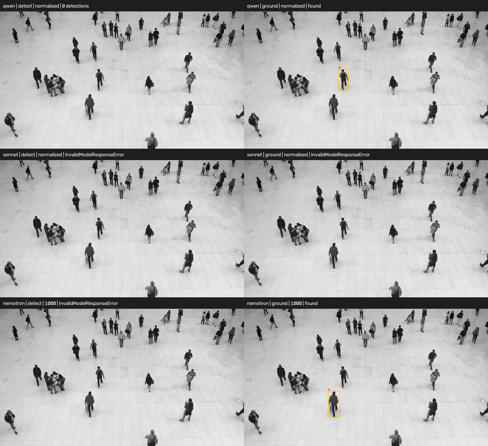
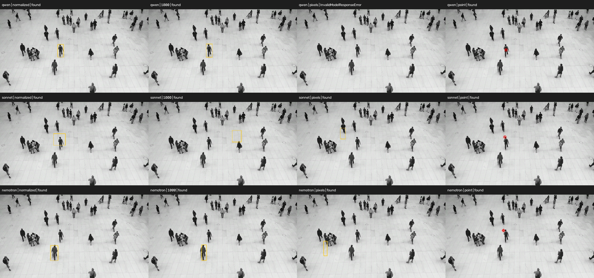

# VLM Task Design

Status: five-operator MVP with box/point grounding; box-scale extensions remain planned.
Recorded 2026-10-25; updated 2026-11-03.

## Goal

Expose model capabilities as explicit tasks with meaningful input and output
boundaries. Users choose a task and a model connection; the task prepares the
request and interprets the prediction. Structured output reliability and visual
accuracy are separate evaluation concerns.

The initial research included vision-language-programs and the supplied VLM
research report. This document records the resulting design rather than
treating the report as an API specification. In particular, boxes and instance
masks may overlap, VAW means Visual Attributes in the Wild, and ordinal ratings
are distinct from continuous scores.

## Task catalog

The first five task contracts are implemented. The remaining contracts describe
the intended direction, not exported placeholders or finalized signatures.

| Task | User intent and inputs | Result |
|---|---|---|
| Classify | Image, label choices, subject/property context | Exactly one label |
| ClassifyMultiLabel | Image, independently applicable label choices, context | Zero or more labels |
| Detect | Image, labels and context; exhaustive instance search | Collection of labeled boxes, possibly empty |
| Ground | Image, one target and context; resolve one match | One location (box or point), not found, or ambiguity |
| Attributes | Image, named categorical attributes and their choices | One allowed value per attribute |
| Verify | Image and statement | Typed verification decision |
| Score | Image and an assessment criterion with a defined continuous scale | Value in that scale; not a confidence probability |
| Count | Image and target | Nonnegative count |
| ReadText | Image, optional reading constraints | Text and applicable layout information |
| Answer | Image and question | Free-text answer |
| Caption | Image; predefined caption instruction | Factual caption without a required question |
| Embed | Image or text through a suitable representation model | Vector with modality and embedding-space identity |
| Compare | Compatible embeddings | Similarity; initially cosine |
| Rank | Image, candidates and criterion | All candidates in order, with explicit tie semantics |

Segmentation, semantic segmentation, pose/keypoints, oriented boxes, physical
measurement, ordinal ratings, document field extraction, scene graphs, and
video are deferred.

### Naming

Prefer concise task names with clear input and output contracts:
- `Attributes` predicts configured categorical properties; its plural noun is
  an intentional exception to action-based names.
- `Answer` is clear from its question input.
- `ReadText` makes text extraction explicit.
- `ClassifyMultiLabel` distinguishes independent labels from exclusive classification.

## Classify vs ClassifyMultiLabel vs Attributes

All three tasks predict categorical properties from an image using configured
choices. Context identifies the subject and property being assessed: choices
such as clean/dirty alone do not identify the subject, so supply context such as
"Assess cleanliness of the visible windows." Context should also specify an
aggregation rule where several subjects appear. An image-level task does not
implicitly become per-instance classification.

The distinction is how choices are organized and returned:

- `Classify` chooses exactly one label from one configured set, such as
  clean/dirty for window cleanliness. Labels can be names or name-to-description
  mappings.
- `ClassifyMultiLabel` returns zero or more independently applicable labels
  from one configured set, such as glass, reflective, and dirty. Labels can
  also have descriptions; choices are not grouped into named attributes.
- `Attributes` returns one categorical value for each named attribute, each
  with its own choices, such as cleanliness: clean/dirty and material: glass/wood.
  Binary attributes use explicit choices such as yes/no.

Top-k alternatives to an exclusive decision are not multi-label predictions.
Classify and ClassifyMultiLabel remain separate; the previous proposal to merge
them using a multi_label flag is superseded. Classical softmax and independent
sigmoid heads motivate this distinction but are not required execution
mechanisms for VLMs.

Attributes performs categorical attribute prediction/recognition. "Feature
extraction" commonly means numerical representations, so ExtractFeatures would
be misleading for categorical attributes.

## Detection vs Grounding

Both tasks localize image content using caller-defined vocabularies,
descriptions, and context. Descriptions may include attributes and relationships;
how a target is expressed does not define the task. Both currently return boxes.

The distinction is requested cardinality and how multiple matches are handled:

- `Detect` requests all matching instances of supplied labels and returns a
  collection of labeled boxes, possibly empty.
- `Ground` requests resolution of one target and returns one location,
  not_found, or ambiguous. Several plausible matches require ambiguity unless
  context resolves the choice; there is no selection="all" mode.

Finding only one actual instance does not turn exhaustive detection into
grounding. The requested behavior determines the task.

For a busy scene, "person wearing a black backpack" can describe several
instances. Requesting every such person is Detect, with a descriptive label:

```python
Detect(
    backend,
    labels={"person_with_black_backpack": "A person wearing a black backpack"},
    context=(
        "Find every matching person. Return a box around the whole person, "
        "not just the backpack. Include partially visible people when the "
        "backpack criterion is visually supported."
    ),
)
```

Each matching person receives a separate box with the same label. The result
can be empty, contain one instance, or contain several; labels need not be bare
object categories.
Localizing backpacks themselves would require a different description and box
scope. A dark shirt or a backpack of indeterminate color does not establish
that a person meets the black-backpack criterion.

Ground with the same description requests one person and should report
ambiguous if several people satisfy it. To resolve one, supply a distinguishing
spatial or relational description, or an explicit selection rule such as
"the leftmost person wearing a black backpack." Do not silently select the
first match or enclose several people in one box. Returning ambiguity is a
valid task outcome, separate from malformed output or execution failure.

### Visual example: Detect versus Ground

The following experiment used the same **"a person wearing a black backpack"**
criterion for both tasks on a 1920×1080 image. Detect requested every matching
person; Ground requested one. Both requested boxes around whole people.
Rows are Qwen3 VL 235B, Claude Sonnet 4.6 and Nemotron Nano 12B v2 VL;
columns are Detect (left) and Ground (right).



| Model | Coordinate scale | Detect: all matches | Ground: one match |
|---|---|---|---|
| Qwen | normalized | Accepted empty collection | Selected the central backpack wearer |
| Sonnet | normalized | Rejected: normalized x coordinates exceeded 1 | Rejected: prose before JSON, although the trailing object declared ambiguous |
| Nemotron | 1000 | Rejected: malformed JSON | Selected a different person lower in the image |

These are actual model responses, not idealized examples of successful
exhaustive detection. An empty collection is structurally valid but does not
establish absence; rejected outputs have no accepted boxes to draw. The
comparison illustrates the different requested cardinalities and observed
behavior. It does not establish either task's accuracy. Each condition had one
independent call, temperature 0, max_tokens 4096, prompted structured output and
zero correction retries. The later output-mode experiment below explicitly
allowed choosing any matching person.

YOLO-World fits Detect because it predicts matching instances. SAM-style models
need capability-specific treatment: point/box-prompted masks, automatic mask
proposals, and text concept segmentation are different capabilities. They
should map to the corresponding task contract when implemented; model family
names are not sufficient capability declarations.

Overlapping detected instances are valid. Coordinate and geometry options are
specified under [Task Configuration](#task-configuration).

## Task Configuration

Ground supports a default target, per-call targets and box or point geometry.
Current operators use normalized model coordinates and return pixel locations.
The box_scale extension below remains an accepted design pending implementation.

### Grounding target

- `Ground(model, target=None, *, context=None, geometry="box")` stores an optional default target.
- `task(image)` uses that default; `task((image, target))` supplies or overrides
  it for one call without changing the stored target or instruction.
- Targets must be nonempty strings. Calling without either target fails before
  inference.

### Box configuration

`box_scale` selects the model-facing coordinate convention for Detect and
Ground. The default is `"normalized"`; select a scale by evaluating the chosen
model. Ground's geometry selector is described under
[grounding method](#grounding-method).

```python
Detect(model, labels, *, context=None, box_scale="normalized")
Ground(model, target=None, *, context=None, geometry="box", box_scale="normalized")
```

Let W and H be the submitted ImagePayload's width and height. All modes request
xyxy boxes and return floating-point pixel boxes with image_size = (W, H).
Fractional coordinates are valid, including in pixel mode; image boundaries
include W and H.

| box_scale | Model-facing bounds | Conversion to public pixel coordinates |
|---|---|---|
| "normalized" | x and y in [0, 1] | x_pixel = x * W; y_pixel = y * H |
| "1000" | x and y in [0, 1000] | x_pixel = x * W / 1000; y_pixel = y * H / 1000 |
| "pixels" | x in [0, W]; y in [0, H] | Use coordinates directly |

- Each axis spans the full image independently; in `"1000"` mode, 1000 is
  the right boundary for x and the bottom boundary for y.
- The selected scale controls coordinate instructions, schema bounds,
  validation and conversion. Every box requires finite coordinates within those
  bounds, with x1 < x2 and y1 < y2.
- Conversion uses the configured scale exactly, without guessing units,
  clipping boxes, swapping coordinates or repairing malformed geometry.
- Unsupported `box_scale` values are invalid configuration.

<details>
<summary>Experiment: box coordinate scale across three models</summary>

#### Grounding scale experiment: central remote

Recorded 2026-10-26. We requested **"the remote control near the middle of the
image, immediately to the left of the right-hand cat"**, with context
"Resolve the described remote as a single whole object."

The original image was 640×480, with no cropping or resizing. Each of three
models received one independent request per scale (nine calls), using Bedrock
in ap-northeast-1, prompted structured output, temperature 0, max_tokens 4096,
and zero correction retries. Target, context and non-coordinate instructions
were held constant; coordinate wording and schema bounds followed the selected
mode. An example-local bridge exercised the planned configuration; the public
box_scale constructor option remains pending implementation.

The reference was the existing YOLO prediction for the intended remote:
pixel xyxy (334.117, 76.514, 370.768, 187.507). Reference coordinates were used
only for evaluation. The table reports box IoU; the matching threshold was 0.5.

| Model | normalized [0, 1] | [0, 1000] | pixels |
|---|---|---|---|
| Qwen3 VL 235B (`qwen.qwen3-vl-235b-a22b`) | 0.910 | 0.894 | Invalid JSON |
| Claude Sonnet 4.6 (`jp.anthropic.claude-sonnet-4-6`) | 0.287 | 0.121 | 0.414 |
| Nemotron Nano 12B v2 VL (`nvidia.nemotron-nano-12b-v2`) | 0.511 | 0.608 | 0.000 |

Four conditions met the threshold. All eight accepted responses reported found;
none reported not_found or ambiguous. Qwen's pixel response failed JSON parsing.
Nemotron's pixel response passed structure, geometry and range validation but
placed its box elsewhere: (522, 157, 562, 382). Those values resemble a
1000-scale box yet also fit the image's pixel bounds. Validation cannot prove
that the model used the requested units, and the task must not infer different
units from an accepted response.

These observations support explicit scale selection and evaluation per model
and task. Qwen worked best here with normalized coordinates; Nemotron improved
with 1000-scale coordinates. Sonnet remained below the matching threshold in
every mode. This single image and one call per condition measure agreement
with a YOLO prediction, not ground-truth accuracy or repeatability.

The [full protocol and raw results](https://github.com/trained-by-humans/vlm-tasks/blob/main/experiments/archive/vlm_remote_grounding/README.md)
include prompts, per-model responses, box coordinates and summaries. Use the
[examples](../examples/README.md) for new runs.

</details>

### Grounding method

`geometry` selects Ground's output shape without changing its single-target
semantics. It is implemented; the planned signature above combines it with
the future `box_scale` option.

- `geometry="box"` is the default and requests one bounding box using the
  selected `box_scale`.
- `geometry="point"` requests one point inside the target, preferably near
  the center of its visible body (the visible torso for a person). It predicts
  location directly from the image and description, without a point hint,
  segmentation pass or inferred box.
- Point mode uses finite normalized x and y in [0, 1], relative to the full
  image. The origin is top-left; x increases rightward and y downward. Public
  coordinates are floating-point pixels: x_pixel = x * W, y_pixel = y * H.
- Unsupported `geometry` values are rejected. The planned `box_scale` option
  will apply only to boxes and reject a nondefault value in point mode.

GroundingResult adds geometry and point to the existing status,
box and image_size fields. Point contains numeric pixel x and y. For found,
exactly the selected geometry is present; for not_found or ambiguous, both box
and point are null. The point response schema requests status and point only,
with no box or extra fields. `Point(x, y)` is exported with pixel coordinates.

### Visual example: effect of geometry and coordinate scale

Geometry and coordinate scale affected localization and output validity
differently across models. Evaluate these settings for the chosen model
and task.

<details>
<summary>Show the screenshot and comparison across three models</summary>

This experiment repeated grounding of **"a person wearing a black backpack"**
with all three models and all four output modes. Each request explicitly
allowed selecting any one matching person. All twelve were fresh calls with
the same criterion and selection rule; box modes requested the whole person,
and point mode requested an interior point, preferably near the torso center.

Rows are Qwen, Sonnet and Nemotron. Columns are normalized box, 1000-scale box,
pixel box and normalized point. Yellow rectangles are accepted box predictions;
red markers are predicted points. No prediction is drawn for a rejected output.



| Model | Normalized box | 1000-scale box | Pixel box | Normalized point |
|---|---|---|---|---|
| Qwen | Closely encloses central backpack wearer | Closely encloses same person | Rejected: list under x1 instead of four numeric box fields | Inside the same person's backpack/torso |
| Sonnet | Shifted upward; incomplete | Mostly floor | Misplaced | Near upper-left head boundary; misses torso preference |
| Nemotron | Encloses lower person; black backpack uncertain | Narrower box on same person | Misplaced | On floor just left of central person's head |

All three point responses passed validation; eleven of twelve responses were
accepted overall. Qwen's point was a useful localization, while the other
points were near the head boundary or outside the person. Point output is a
useful alternative with a simpler response, and scale affected box placement
and format compliance. This one call per condition does not show that points
are universally more accurate. There are no ground-truth backpack annotations
or quantitative accuracy claims for this scene.

Settings were Bedrock in ap-northeast-1, prompted output, temperature 0,
max_tokens 4096 and zero correction retries, on the full 1920×1080 image without
task-side cropping or resizing. Model IDs match the central-remote experiment.
The experiment used local task preparation and schemas without changing the
public package. Exact prompts, coordinates and responses are recorded in the
[Detect versus Ground archive](https://github.com/trained-by-humans/vlm-tasks/blob/main/experiments/archive/vlm_backpack_people/README.md)
and [grounding modes archive](https://github.com/trained-by-humans/vlm-tasks/blob/main/experiments/archive/vlm_backpack_grounding_modes/README.md).
The two comparison figures are also available under `docs/assets/`.
See the [experiment index](https://github.com/trained-by-humans/vlm-tasks/blob/main/experiments/README.md) for all recorded runs.

</details>

## Public and model-facing boundaries

    ImagePayload
        -> task preparation (context, choices, instruction, response schema)
        -> ModelRequest
        -> ModelBackend
        -> ModelResponse
        -> task validation and conversion
        -> dedicated result dataclass

Tasks share a communication envelope. Request content and output schemas vary
by task; adapters do not dispatch on task names or own task-specific parsers.
ResponseSpec carries a JSON Schema and a validator; ModelResponse contains
plain structured data. These integration types contain no PydanticAI types.
The task owns instructions, schema constraints, response validation and
coordinate conversion; the backend executes the supplied specification. Tasks
also validate returned data at their boundary before conversion. Malformed or
task-invalid output follows InvalidModelResponseError and the configured
correction-retry policy.

Final results are dedicated dataclasses, not TensorRegistry values. Registries
serve mutable tensor processing; these predictions are finalized outcomes.
Optional scores must have a documented meaning and source. The MVP does not
request self-reported confidence or invent probabilities.

Ground accepts one image or `(image, target)` value. Its pipeline contract
requires `tuple[ImagePayload, str]` without a constructor target; with a default,
it accepts either an ImagePayload or that tuple. Pipeline passes the tuple as
one argument. A tuple always supplies a nonempty string target; image-only calls
use the constructor default. The task builds each instruction locally. Other
task settings remain constructor-only.

## Model communication alternatives

| Route | Examples | Integration considerations |
|---|---|---|
| Direct local Python runtime | Transformers, vLLM engine, SGLang engine, MLX-VLM | Requires a runtime bridge around already loaded objects |
| Local inference server | vLLM, SGLang, llama.cpp, Ollama, LM Studio | Often exposes OpenAI-compatible chat; native APIs also exist |
| Hosted inference | HF Inference Providers, Together AI, OpenRouter | Model catalog, image support and structured-output support vary |
| Native remote API | OpenAI Responses/Chat, Anthropic Messages, Gemini, Bedrock Converse | Distinct API formats and authentication |

These are eligible routes, not a compatibility certification or a ranking of
deployment popularity. The MVP uses the routes supported by a supplied
PydanticAI Model. For directly loaded Transformers weights, the package provides
`TransformersModel`, a PydanticAI adapter wrapping caller-owned weights and a
multimodal processor. Model loading, device placement and authentication remain
application concerns. See the [Transformers guide](guides/huggingface-transformers.md).

A communication implementation usually corresponds to an API/runtime; each
instance selects a particular model. Qwen and Gemma can share an integration
when their runtime provides the same API. A shared generation interface does
not establish accuracy or useful aligned embeddings. Ordinary instruction
checkpoint hidden states are not automatically equivalent to trained retrieval
embeddings such as Qwen3-VL-Embedding.

## PydanticAI, Pydantic, BAML, and LiteLLM

| Choice | Useful contribution | Decision |
|---|---|---|
| Pydantic | Schema generation and data validation | Used privately for internal wire schemas |
| PydanticAI | Provider integration, image messages, output modes and correction execution | MVP execution engine, behind PydanticAIBackend |
| BAML | Typed task functions, dynamic types, schema-guided parsing and modular request/parse APIs | Design reference; no mandatory DSL or generated clients |
| LiteLLM | Common calling interface across providers and proxies | Eligible future integration; no additional MVP dependency |

PydanticAI's direct API supplies requests without the Agent's full structured
parsing/retry behavior. The MVP uses Agent internally for structured execution.
Its StructuredDict helper forwards a JSON Schema but does not itself validate
all constraints: the response validator must do so.

Borrowed practices: one response specification as the source of truth; native,
tool and prompted output paths; independently testable preparation/validation;
dynamic vocabularies; explicit correction budgets; and provider-independent
results. Formatting success does not prove that the right object was found or
that exhaustive detection was achieved.

The BAML modular request/parse and TypeBuilder references below document the
v0 generated-client system. The documentation identifies v1 as a separate
language in public beta; adopting it would require a separate version decision.

## MVP dependency and ownership decisions

- Use an explicit PydanticAIBackend wrapping an initialized PydanticAI Model.
- Keep all task-facing types independent of PydanticAI.
- Keep provider authentication, SDK clients, connection lifetime and model
  selection in application code. Already initialized Bedrock Runtime clients
  are supported through PydanticAI's BedrockProvider.
- Use pydantic-ai-slim 2.61.0, without mandatory provider SDK bundles.
- Require Python 3.11+ only for VLM; core stays independent.
- Default to prompted output and zero correction retries. Native/tool modes
  are explicit options for suitable models/APIs.
- Separate correction retries from SDK transport retries; do not hide either
  when benchmarking.
- Use fresh histories for every prediction even when sharing a backend.

Earlier proposals for direct PydanticAI Model arguments, provider-string
shortcuts, custom callable bridges, automatic loading, and per-model task
bindings are not part of this MVP. Native embeddings and tensor predictions
must not be forced through a text-generation path in a later implementation.

## Evaluation roadmap

Evaluate checkpoint + task instruction/schema + adapter/backend settings +
output mode + retry budget + dataset/protocol. Record prompt/parser and
dependency versions. Unit tests establish contracts, not model proficiency.

See [grounding validation](validation.md#grounding-validation) for the current
dataset protocol, box and point metrics, and evaluation limits.

Starting points include standard image classification datasets; COCO for
detection; RefCOCO-style data for grounding; VAW/OVAD for attributes; KonIQ-10k
for a future quality score; ICDAR/IAM for OCR; VQAv2/GQA for QA; and
Flickr30k/COCO retrieval for embedding comparison. Grounding evaluation needs
explicit absent and ambiguous cases in addition to successful references.
Use task-appropriate accuracy, precision/recall, IoU/mAP and attribute metrics.
Evaluate point locations against target masks or point annotations separately
from box IoU; a point does not describe an object's extent. Valid geometry and
coordinate bounds cannot establish that the model found the right target or
used the requested units. Calibration needs separate evidence. Additional
dataset adapters and live comparative benchmarks are future work.

## Sources

Reviewed 2026-10-25:

- [Vision-language programs](https://github.com/ml-research/vision-language-programs)
- [PydanticAI models and providers](https://pydantic.dev/docs/ai/models/overview/)
- [PydanticAI structured output](https://pydantic.dev/docs/ai/core-concepts/output/)
- [PydanticAI direct requests](https://pydantic.dev/docs/ai/core-concepts/direct/)
- [PydanticAI multimodal inputs](https://pydantic.dev/docs/ai/core-concepts/input/)
- [PydanticAI Bedrock clients](https://pydantic.dev/docs/ai/models/bedrock/)
- [PydanticAI HF inference](https://pydantic.dev/docs/ai/models/huggingface/)
- [PydanticAI slim installation](https://pydantic.dev/docs/ai/overview/install/#slim-install)
- [BAML modular API](https://docs.boundaryml.com/guide/baml-advanced/modular-api)
- [BAML dynamic types](https://docs.boundaryml.com/ref/baml_client/type-builder)
- [LiteLLM vision](https://docs.litellm.ai/docs/completion/vision)
- [SGLang vision API](https://docs.sglang.io/docs/basic_usage/openai_api_vision)
- [vLLM serving](https://docs.vllm.ai/en/latest/serving/online_serving/)
- [llama.cpp server](https://github.com/ggml-org/llama.cpp/tree/master/tools/server)
- [Ollama compatibility](https://docs.ollama.com/api/openai-compatibility)
- [MLX-VLM](https://github.com/Blaizzy/mlx-vlm)
- [LM Studio compatibility](https://lmstudio.ai/docs/developer/openai-compat)
- [Qwen3-VL embeddings](https://github.com/QwenLM/Qwen3-VL-Embedding)
