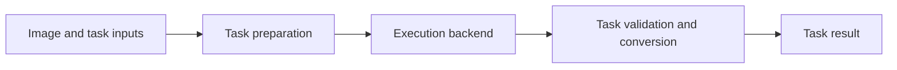

# VLM Task Design

> This document is an architectural blueprint. It describes intended contracts,
> design choices, and tradeoffs, rather than implementation status or supported
> integrations. Exact APIs belong in the [reference](reference.md).

## Context and goals

Vision-language models expose overlapping capabilities through different
runtimes, APIs, and output conventions. A task layer should express what the
caller wants independently of how a particular model executes it.

The design prioritizes:

- Explicit task semantics, including cardinality, ambiguity, and absence.
- Stable inputs and results across model providers and deployment routes.
- Separation of task logic, model execution, and application infrastructure.
- Independent evaluation of output validity and visual accuracy.

## Task catalog

Tasks are distinguished by user intent and result semantics, rather than by
model family or prompt format.

| Task | Intent and inputs | Result |
|---|---|---|
| Classify | Image, mutually exclusive labels, context | Exactly one label |
| ClassifyMultiLabel | Image, independently applicable labels, context | Zero or more labels |
| Attributes | Image, named categorical properties and their choices | One allowed value per property |
| Detect | Image, labels, context; find every matching instance | Collection of labeled boxes, possibly empty |
| Ground | Image, target description, context; resolve one match | One location, absence, or ambiguity |
| Verify | Image and statement | Verification decision |
| Score | Image, assessment criterion, defined continuous scale | Value on that scale |
| Count | Image and target | Nonnegative count |
| ReadText | Image and reading constraints | Text and relevant layout |
| Answer | Image and question | Free-text answer or unanswerable outcome |
| Describe | Image and description context | Factual natural-language description |
| Embed | Image or text and an embedding model | Vector with embedding-space identity |
| Compare | Compatible embeddings | Similarity under a defined metric |
| Rank | Image, candidates, comparison criterion | Ordering with explicit tie semantics |

Segmentation, keypoints, document extraction, and video require their own
contracts for geometry, structure, or time. They should follow the same task
boundary principles.

## Task boundaries

| Approach | Advantages | Tradeoffs |
|---|---|---|
| One generic image-to-answer task | Small interface; flexible experimentation | Callers must recover task semantics and validate arbitrary responses |
| One configurable task with mode flags | Shares related behavior | Flag combinations complicate inputs, results, and validation |
| Explicit tasks with shared execution | Clear contracts and task-specific evaluation | More public concepts; shared behavior needs careful factoring |

**Design direction:** use explicit tasks where result meaning or cardinality
differs, and share request preparation and execution mechanisms underneath.

Classify chooses one label; ClassifyMultiLabel chooses independently applicable
labels; Attributes organizes choices into named properties. Top-k alternatives
to a single decision are distinct from multi-label predictions. Context should
identify the subject, property, and aggregation rule when several subjects are
visible; image-level classification does not imply per-instance prediction.

Continuous scores, ordinal ratings, and confidence probabilities also have
different meanings. A task should define its scale and interpretation rather
than treating every numerical answer as confidence. Embeddings require a
compatible representation space; ordinary generation-model hidden states do
not automatically provide useful retrieval embeddings.

### Descriptions and question answering

Describe produces a factual description, with context controlling focus and
detail. Answer responds to an explicit question with free text or an
unanswerable outcome. Questions can be supplied per call without changing the
task's defaults. Both tasks share execution with the other operators.

They overlap in the information they can express. Use a task with a constrained
result when the application needs its guarantees:

| Text request | Task and structured guarantee |
|---|---|
| “What material is the chair?” | `Attributes` for an allowed categorical value |
| “Which option is correct?” | `Classify` for exactly one choice |
| “How many dogs?” | `Count` for a nonnegative integer |
| “Where is the dog?” | `Ground` for coordinates and resolution status |
| “What does the sign say?” | `ReadText` for transcription and layout |
| “Is a dog present?” | `Verify` for a verification decision |

Count, ReadText, and Verify are planned contracts. A description or answer may
express their information in prose, but does not guarantee the corresponding
type, vocabulary, geometry, or completeness. Several reference captions or
human answers in a dataset are evaluation alternatives for one prediction;
they do not require multiple task results. An answer of “no” or “zero” remains
an answered outcome, distinct from an inability to answer or an execution failure.

### Detection vs grounding

Detection requests every matching instance. Grounding resolves one target and
reports ambiguity when several matches remain without a selection rule.
Descriptions can include attributes or relationships in either task; descriptive
language alone does not distinguish them.

For example, finding every person wearing a black backpack is detection.
Locating the leftmost such person is grounding. Finding only one actual match
does not change an exhaustive request into a single-target request. Overlapping
instances are valid, and ambiguity is a meaningful outcome rather than an
execution failure.

## Task configuration

| Approach | Advantages | Tradeoffs |
|---|---|---|
| Fixed configuration per task instance | Reusable setup; easy to inspect | Dynamic targets or vocabularies require additional instances |
| Complete configuration per request | Self-contained calls; natural for changing inputs | Repetition and more request validation |
| Defaults with request-specific overrides | Reuse with dynamic targets and choices | Precedence and replacement rules must be explicit |

**Design direction:** allow stable defaults and explicit request-specific task
inputs. Overrides must not mutate shared configuration, so independent calls
remain isolated. Missing required inputs should fail before model execution.
Context should clarify intended meaning without silently changing the task's
cardinality or result contract.

## Geometry and coordinates

Geometry describes what a localization result means; coordinate scale describes
how it is encoded. These are separate choices.

| Geometry | Advantages | Tradeoffs |
|---|---|---|
| Bounding box | Describes location and approximate extent; useful for crops and detection | More coordinates; includes background and approximates irregular shapes |
| Interior point | Compact location for referring or interaction tasks | Does not describe extent; needs a defined rule for acceptable placement |
| Mask | Describes detailed object extent | Larger output; requires a segmentation-capable execution path |

**Design direction:** let grounding request a box or an interior point without
changing its single-target semantics. Treat masks as a separate segmentation
contract. Absence and ambiguity carry no invented geometry.

| Model-facing coordinate convention | Advantages | Tradeoffs |
|---|---|---|
| Normalized | Independent of image resolution | Fractional precision and model familiarity can affect results |
| Fixed range, such as 0–1000 | Resolution-independent with a simple numeric scale | Requires explicit conversion; model conventions may differ |
| Pixels | Direct relationship to the submitted image | Depends on image dimensions and any resizing or cropping |

**Design direction:** make the model-facing convention explicit and normalize
public locations to original-image pixels. Preserve the relationship between
submitted and original images when preprocessing changes geometry. Reject
invalid geometry rather than guessing units or silently repairing coordinates.
A valid location can still identify the wrong object.

## Architectural boundaries

| Boundary | Responsibility |
|---|---|
| Application | Model selection, loading, credentials, resource lifetime, deployment policy |
| Task | Intent, instructions, response constraints, semantic validation, result conversion |
| Execution backend | Message or runtime translation, output mechanisms, execution, correction attempts |

| Architecture option | Advantages | Tradeoffs |
|---|---|---|
| Provider logic inside each task | Direct access to provider features | Repeated integration work; task semantics can drift across providers |
| Shared execution boundary | Tasks and providers evolve independently | Requires a clear capability contract and translation layer |

**Design direction:** share a task-independent execution boundary. Tasks supply
the request and response specification; backends should not dispatch on task
names or own task-specific interpretation. Integrations should generally follow
an API or runtime rather than a model checkpoint.

Prefer dedicated, immutable task results over generic mappings or mutable
tensor registries. This makes outcomes clear at the cost of maintaining explicit
result contracts. Keep provider and orchestration framework types behind the
execution boundary. Native embeddings and tensor predictions need suitable
execution paths rather than being forced through text generation.

## Model communication alternatives

| Route | Examples | Advantages | Tradeoffs |
|---|---|---|---|
| Direct local Python runtime | Transformers, vLLM engine, SGLang engine, MLX-VLM | Access to loaded models and native outputs; no server boundary | Runtime coupling, device management, and model-specific preprocessing |
| Local inference server | vLLM, SGLang, llama.cpp, Ollama, LM Studio | Separate model lifecycle; shared serving and batching | Server operations and API capability differences |
| Hosted inference | HF Inference Providers, Together AI | Managed infrastructure and model catalogs | Remote data transfer, service limits, cost, and catalog changes |
| Inference gateway / router | LiteLLM SDK/Proxy, OpenRouter | Common API, provider routing, and centralized policies | Extra abstraction or network hop; upstream capabilities still vary |
| Native remote API | OpenAI, Anthropic, Gemini, Bedrock | Direct access to provider-specific capabilities | Distinct authentication, messages, and output conventions |

These routes can compose: a gateway may route to hosted inference or a native
API. A common API reduces integration work but does not establish equivalent
image handling, structured output, or model quality.

**Design direction:** keep deployment choice outside task semantics. Require
explicit capabilities for the selected model and route, and expose unsupported
combinations instead of silently changing task behavior.

## Structured execution and validation

The response specification should be the source of truth for both generation
constraints and validation. Generation-time constraints reduce malformed output;
validation remains necessary at the task boundary.

| Approach | Examples | Advantages | Tradeoffs |
|---|---|---|---|
| Schema validation library | Pydantic | Typed constraints and schema generation | Does not provide model execution by itself |
| Structured execution framework | PydanticAI | Combines provider integration, multimodal messages, output handling, and correction | Framework dependency and provider capability differences |
| Typed prompt DSL | BAML | Declarative task definitions, parsing, and dynamic schemas | Additional language, tooling, and generated-client workflow |
| Direct SDKs with custom orchestration | Provider SDKs and application logic | Fine control and fewer framework assumptions | More parsing, validation, retry, and integration code to maintain |

These approaches overlap and can compose. **Design direction:** prefer
PydanticAI for structured execution and Pydantic for schema validation behind
framework-independent task contracts. BAML offers an alternative when its
declarative workflow justifies the additional tooling.

### Output modes

| Mode | Advantages | Tradeoffs |
|---|---|---|
| Native schema-constrained output | Stronger generation-time structure guarantees | Availability and supported schema features vary |
| Tool-based output | Reuses structured function arguments | Depends on tool support and reliable tool selection |
| Prompted output | Broad applicability | More formatting failures and parsing ambiguity |

**Design direction:** select the mode explicitly for the model and route.
Apply the same task validation regardless of the generation mechanism.

Correction attempts can improve valid-output rates but add latency, cost, and
variability. Keep their budget explicit and separate from transport retries.
Distinguish valid task outcomes, invalid responses, and execution failures.
Independent predictions should not inherit conversation history.

## Evaluation principles

Evaluate the complete combination of model, task instructions, response
constraints, preprocessing, output mode, and retry policy. A contract test
establishes software behavior; it does not establish model proficiency.

- Measure structural validity separately from visual correctness.
- Choose metrics that match the task: categorical accuracy, detection
  precision and recall, localization quality, or retrieval performance.
- Evaluate points and boxes according to their different spatial meanings.
- Include absence, ambiguity, and multiple matches in localization evaluation;
  measure exhaustive detection separately from single-target resolution.
- Record failures, latency, cost, and correction attempts alongside quality.
- Treat probability calibration as a separate claim requiring evidence.

Task intent should remain stable across backends even when their measured
performance differs. Concrete protocols and experimental results belong in
[validation documentation](validation.md) and the
[experiment archive](https://github.com/trained-by-humans/vlm-tasks/blob/main/experiments/README.md).

## References

- [Vision-language programs](https://github.com/ml-research/vision-language-programs)
- [PydanticAI models and providers](https://pydantic.dev/docs/ai/models/overview/)
- [PydanticAI structured output](https://pydantic.dev/docs/ai/core-concepts/output/)
- [BAML documentation](https://docs.boundaryml.com/)
- [LiteLLM documentation](https://docs.litellm.ai/)
