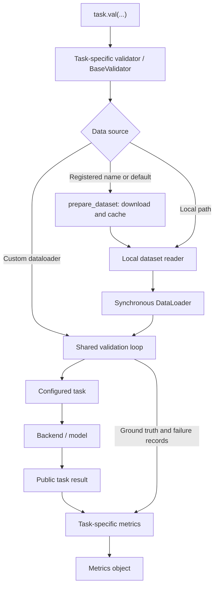

# Validation

Validation runs a configured VLM task on labeled examples and compares its
predictions with the annotations. It measures task accuracy, inference failures,
and time per sample. It does not train or update the model.

Use it to:

- Check that a model, backend, and structured output configuration work together.
- Compare models, prompts, task context, or generation settings on the same data.
- Find regressions and inspect failures before using a task in a pipeline.
- Measure localization or classification quality on your own domain data.

Each sample makes an independent task call: one image for classification or
detection, one image-expression pair for grounding, or one object crop for
attributes. Start with 10 samples to
check execution and timing, then 100 for an initial comparison. Use the complete
validation split for a benchmark result. Ordered subsets and small smoke datasets
can give unrepresentative scores.

## Calling validation

With an initialized backend, the task's `.val()` method prepares its default
dataset, runs inference, and returns a metrics object:

```python
from ml_pipes.vlm import Ground

task = Ground(backend)
metrics = task.val(split="val", max_samples=100)

print(metrics.results_dict)  # aggregate scores and failure statistics
print(metrics.summary())    # per-category scores and support
print(metrics.failures)     # individual inference failures
```

The result is also stored as `task.metrics`. Each call starts a new evaluation.
Task settings such as labels, descriptions, context, and grounding geometry come
from the operator; model settings, output mode, and retries come from its backend.

For command-line usage, see the separate
[validation example](../examples/README.md#dataset-validation).

## Metric definitions and failures

- **Classification:** top-1 accuracy across evaluated images, plus per-class
  precision/recall/F1 and a confusion matrix. Class selection happens before
  evaluation; `class_map` can select and alias dataset classes to task labels.
- **Detection:** match boxes of the same class one-to-one, in descending IoU
  order, using inclusive `match_iou`. Aggregate precision/recall/F1 pool TP/FP/FN
  across classes. Negative images remain in evaluation after class selection.
  No AP/mAP is computed because predictions have no confidence ranking.
- **Grounding, box:** ordinary continuous-coordinate intersection over union,
  scored in original-image pixels, with inclusive thresholds of 0.5, 0.75, and
  0.9. Result keys are `accuracy_iou_0.5`, `accuracy_iou_0.75`,
  `accuracy_iou_0.9`, and `mean_iou`.
- **Grounding, point:** `point_in_box_accuracy` counts a hit when the predicted
  point lies inside the target box, including its edges. It is a coarse proxy
  for mask containment and is not directly comparable to box-IoU accuracy.

- **Attributes:** categorical accuracy over known targets, mean accuracy across
  supported attribute groups, and macro F1 averaged first within each group and
  then across supported groups. This adapts OVAD to categorical predictions;
  it is distinct from OVAD's official attribute mAP protocol.

`ModelExecutionError` and `InvalidModelResponseError` are recorded and evaluation
continues. Classification failures are incorrect predictions; detection failures
produce no predicted boxes; grounding failures score zero; attribute failures
count as incorrect for every known target on that object. They remain included
in sample counts and relevant score denominators. Data, setup, and programming
errors stop validation instead of becoming model failures.

For grounding, valid `not_found` and `ambiguous` responses score zero IoU or a
point miss. `status_counts` tracks valid responses separately from execution
failures. Every evaluated expression enters the score denominator, and evaluated
unique-image counts include images whose calls failed. Per-category summaries
report expression support; categories are reporting groups, not task labels.

RefCOCO-family annotations do not evaluate rejection quality, annotated ambiguity,
or multiple targets. Point scoring uses target boxes rather than masks. Box
scoring uses ordinary IoU, not MDETR's generalized-IoU evaluator.

## Available validations

Counts below describe the full source dataset or explicitly named split, before
class filtering or `max_samples`. **Total size** describes compressed upstream
archives, excluding model weights and expanded cache files. MB/GB use decimal
units. Grounding storage depends on which images are selected.

| Tasks | Metrics | Dataset | Number of images / classes / expressions | Splits | Partial download? | Total size |
|---|---|---|---|---|---|---|
| `Classify` | Top-1 accuracy; per-class precision, recall, F1; confusion matrix | **CIFAR-10** (`cifar10`, current default) | 60,000 images at 32×32; 10 classes; 50,000 train / 10,000 test | train, val, test; **val aliases test** | Full archive downloaded; only selected split/classes/sample prefix materialized | ≈170 MB (162 MiB) archive |
| `Detect` | Precision, recall, F1; TP/FP/FN at configurable matching IoU | **COCO128** (`coco128`, default) | 128 images; 941 boxes; 71 represented classes within an 80-class vocabulary | train, val; **same 128 images in both** | Full archive downloaded; only selected image prefix materialized | 6.98 MB archive |
| `Ground`, box | Accuracy at IoU ≥0.5 / 0.75 / 0.9; mean IoU | **RefCOCOg UMD** (`refcocog`, default) | **val:** 1,300 unique images; 4,896 expressions and target boxes; 80-category reporting vocabulary | train, val, test | Selected split JSON extracted from a streamed shared archive; only distinct images referenced by selected expressions downloaded | 1.08 GB shared annotation archive; val JSON 2.27 MB; selected images add variable bytes |
| `Ground`, point | Point-in-box accuracy | **RefCOCOg UMD** (`refcocog`, default) | Same expressions and target boxes as box mode; no point annotations required | train, val, test | Same preparation and cache as box mode | Shares the box-mode dataset files |
| `Ground`, box or point | Same grounding metrics for the selected geometry | **RefCOCO UNC / RefCOCO+ UNC**, local data | Counts depend on supplied manifest; one target box per expression | train, val, testA, testB | No automatic download; supply annotations and images | Depends on supplied files |
| `Attributes` | Categorical accuracy; mean attribute accuracy; macro F1; per-group matrices and per-value precision/recall/F1 | **OVAD** (`ovad`, default) | 14,300 source objects; **14,072 eligible objects across 2,000 images**; 22 groups excluding color and clothes color | test; **val aliases the same benchmark**; no train | Pinned annotation archive; only distinct images referenced by selected objects downloaded | 1.13 MB annotation archive; selected COCO val2017 images add variable bytes |

CIFAR-10 and COCO128 contain class/object annotations; the task generates the
model instructions. RefCOCO-family datasets also supply the referring expression
for every call. COCO128 is a smoke dataset whose images come from COCO training
data; its scores do not establish held-out COCO performance.

**Planned classification default: Imagenette v2.** It has 13,394 images across
10 classes: 9,469 train and 3,925 validation, with no official test split.
Published shared train/val archives are approximately 99.0 MB (160px), 341.7 MB
(320px), and 1.56 GB (full resolution); the resized variants set the shortest
side. The automatic downloader currently supports CIFAR-10, not Imagenette, and
an Imagenette resolution has not yet been selected. Prepared local Imagenette
class directories already work with the classification reader; map its WordNet
folder names to readable task labels with `class_map`.

Dataset sources: [CIFAR-10](https://www.cs.toronto.edu/~kriz/cifar.html),
[COCO128 archive](https://github.com/ultralytics/assets/releases/download/v0.0.0/coco128.zip),
[MDETR annotation archive](https://zenodo.org/records/4729015),
[OVAD annotation archive](https://lmb.informatik.uni-freiburg.de/resources/datasets/ovad.zip),
[Imagenette variants](https://github.com/fastai/imagenette), and
[Imagenette counts](https://www.tensorflow.org/datasets/catalog/imagenette).
COCO128, RefCOCOg val, and OVAD counts above were checked against the source annotations
used by the repository's downloader.

## Configuration and setup

### Dependencies and backend

Install the package from the repository root:

```bash
python -m pip install -e .
```

Install your backend's dependencies and configure access using the
[Bedrock example](../examples/README.md#amazon-bedrock) or
[Transformers guide](guides/huggingface-transformers.md). Detection YAML requires
PyYAML through the validation extra:

```bash
python -m pip install -e '.[validation]'
```

Grounding/OVAD JSON and dataset preparation use the base dependencies. Downloading
requires neither a dataset framework nor a model library. Local dataset readers
do not download data; named-dataset preparation is a separate component.

### Validation options

These are arguments to `task.val()`:

| Argument | Default and meaning |
|---|---|
| `data` | Task default registered dataset; alternatively a registered name or local dataset path |
| `split` | `"val"`; must exist for the selected source |
| `max_samples` | `None`, the entire selected split; limits images for Classify/Detect, expressions for Ground, and eligible objects for Attributes |
| `cache_dir` | Dataset cache location; precedence described below |
| `class_map` | `None`; mapping of dataset names to task labels for classification/detection |
| `match_iou` | `0.5`; detection matching threshold, in `(0, 1]` |
| `images` | Required image directory for local grounding or OVAD annotations; automatic preparation supplies it |
| `dataset` | `"refcocog"`; selects the local grounding annotation filename and expected split protocol |
| `verbose` | `True`; progress and aggregate scores on stderr |
| `dataloader` | Custom loader instead of `data`; see custom datasets below |
| `validator` | Custom validator class instead of the task's built-in validator |

Set `labels`, `context`, and `geometry` on the task constructor. For example:

```python
task = Ground(backend, geometry="point", context="Resolve the whole object.")
metrics = task.val(max_samples=100)
```

Classification/detection retain their configured labels; match dataset names or
use `class_map` for aliases and class selection. Each grounding expression
supplies its target. Attributes retain their complete configured schema, and
their keys select dataset groups. Grounding and attributes reject `class_map`.

Configure model settings, output mode, and correction retries on the backend.
Backend/transport retry policies are separate from structured-output correction.
Transformers supports prompted output and greedy generation; Bedrock supports
prompted, native, or tool output where the model/API permits.

## Default datasets and downloads

Omit `data` to use the task default, or select a registered name
explicitly, such as `task.val(data="refcocog", max_samples=100)`. Local paths and
custom loaders bypass automatic preparation. Use `./cifar10` or
`Path("cifar10")` to identify a local directory whose name matches a registry key.

Prepare data separately without loading a model:

```python
from ml_pipes.vlm.validation import prepare_dataset

prepared = prepare_dataset("refcocog", split="val", max_samples=100)
print(prepared.data, prepared.images)
print(prepared.metadata)
```

Cache location precedence is `cache_dir`, then
`VLM_TASKS_DATASETS_DIR`, then `~/.cache/vlm-tasks/datasets`. Matching requests
verify and reuse prepared files. CIFAR-10 and COCO128 archives have pinned
checksums, as does OVAD; prepared files have SHA256 hashes. RefCOCOg records the extracted
annotation's SHA256, but streaming does not verify the full MDETR archive hash.
Writes are atomic, transient download failures are retried, and preparation
never executes dataset download scripts.

**Partial preparation does not always mean partial network transfer.** CIFAR-10
and COCO128 download and retain a shared archive even for a small request.
RefCOCOg streams the shared MDETR archive until it finds the requested annotation
file, which can require reading unrelated bytes; it then downloads only the
selected distinct images. Larger requests reuse cached annotations and images.
RefCOCOg val/test expressions refer to **COCO train2014** images.
OVAD uses **COCO val2017** images, filters objects before selecting the sample
prefix, and downloads only distinct selected images. Its cache identity includes
selected groups, split, and sample limit. `PreparedDataset.attributes` provides
constructor-compatible choices and descriptions for OVAD; it is `None` for the
other registered sources.

Selection is deterministic: classification filters task classes before applying
the limit and uses class-name/source-record order; detection uses image-filename
order; grounding uses JSON expression order. Repeated images with different
expressions make separate calls. Preparation metadata retains full-source
counts; the prepared manifest and evaluated counts can be smaller.
OVAD preserves source annotation order; different objects in a repeated image
make separate crop calls.

## Validation architecture

The validator binds its task at construction and runs when called without
arguments: `validator = GroundingValidator(task, ...); metrics = validator()`.
The task's `.val()` method handles these steps for normal usage.

The validator gets samples, calls its bound task, and
accumulates evaluation results. It coordinates two main components:

- **Data loader:** provides images and ground truth according to the user's
  dataset configuration, including source/name, split, classes, and sample limit.
- **Evaluator:** compares a specific task's response with ground truth and
  computes the relevant metrics, independently of the dataset provider.

A thin **adapter** bridges the dataset's annotation format and the evaluator's
expected format. For example, it converts source `xywh` or normalized boxes into
original-image pixel `xyxy` boxes and aligns class IDs with labels. A new dataset
format needs an adapter; it can reuse the evaluator when task semantics match.

In the current implementation, data provision spans preparation, dataset readers,
and `DataLoader`. Adaptation happens in dataset readers and validator class
alignment; evaluation spans task-specific `update_metrics` methods and metric
classes. The diagram and table below show these implementation components.



| Component | Responsibility |
|---|---|
| Task `.val()` in [ops.py](../src/ml_pipes/vlm/ops.py) | Selects `ClassificationValidator`, `DetectionValidator`, `GroundingValidator`, or `AttributesValidator`; stores and returns metrics |
| [prepare.py](../src/ml_pipes/vlm/validation/prepare.py) | Registry, source downloads, checksums, cache, subset materialization, and `PreparedDataset` metadata |
| Dataset readers in [data.py](../src/ml_pipes/vlm/validation/data.py) | `ClassificationDataset`, `YOLODataset`, `RefCOCODataset`, and `OVADDataset` validate local annotations and decode images when indexed. OVAD owns group selection, categorical adaptation, object filtering, and cropping. |
| Loaders in data.py | `DataLoader` iterates sample dictionaries synchronously; `ClassificationDataLoader` selects classes before decoding images |
| [validator.py](../src/ml_pipes/vlm/validation/validator.py) | `BaseValidator` owns setup, class alignment, iteration, timing, recoverable failures, and finalization. Task-specific `update_metrics()` methods validate/adapt predictions and ground truth, then delegate comparison and accumulation to the metrics classes. |
| Configured task and backend | Build requests, perform inference, parse structured responses, and apply backend correction retries |
| [metrics.py](../src/ml_pipes/vlm/validation/metrics.py) | `ClassificationMetrics`, `DetectionMetrics`, `GroundingMetrics`, and `AttributesMetrics` both perform evaluation and expose results: their `update()` methods compare predictions with ground truth and accumulate statistics; properties and `summary()` calculate scores from those statistics. These are stateful evaluators and result containers, rather than plain result dataclasses. Grounding prediction extraction also currently happens here. |

The shared loop loads a sample, calls `predict_sample`, records recoverable
inference failures, and calls `update_metrics`. Classification/detection pass
`sample["img"]` to the task; grounding also supplies the expression. Attributes
pass the cropped `sample["img"]` through the same loop. Validation
adds no model preprocessing or inference retries; backend processors own model
input preparation. Finalization records elapsed time and per-sample loading,
inference, and metric timings.

## Using your own dataset

Local paths never trigger downloads. You can use a built-in local format, supply
a custom loader, or extend a validator for another format/task.

### Classification: class directories

```text
animals/
  val/
    cat/a.jpg
    dog/b.jpg
```

```python
from ml_pipes.vlm import Classify

task = Classify(backend, labels=["cat", "dog"])
metrics = task.val(data="/datasets/animals", split="val", max_samples=100)
```

Directories define class names. Images are read without dataset-level resizing
or cropping. Task labels must match dataset names, or supply aliases such as
`class_map={"cat": "feline"}` for a task configured with the label `feline`.
An explicit mapping selects the evaluated dataset classes.

### Detection: YOLO YAML and labels

```text
objects/
  data.yaml
  images/val/a.jpg
  labels/val/a.txt
```

`data.yaml` defines the split and consecutive class IDs starting at zero:

```yaml
path: .
val: images/val
names:
  0: person
```

Each label row is `class_id x_center y_center width height`, with coordinates
normalized to image dimensions. For example, `0 0.5 0.5 0.5 0.5` describes a
centered person box spanning half the image's width and height.

```python
from ml_pipes.vlm import Detect

task = Detect(backend, labels={"pedestrian": "A visible person"})
metrics = task.val(
    data="/datasets/objects/data.yaml",
    class_map={"person": "pedestrian"},
    match_iou=0.5,
)
```

Missing or empty label files represent negative images. Malformed annotations
or unreadable images stop evaluation. The reader converts normalized boxes into
original-image pixel `xyxy` coordinates; segmentation polygon rows are unsupported.
No Ultralytics installation is required.

### Grounding: expression annotations and images

Provide an annotation directory containing the exact filename
`finetune_{dataset}_{split}.json`, plus an image directory. For example,
`finetune_refcocog_val.json` can contain:

```json
{
  "images": [
    {"id": 91, "file_name": "sample.jpg", "width": 640, "height": 480,
     "caption": "the person on the right"}
  ],
  "annotations": [
    {"id": 501, "image_id": 91, "category_id": 1,
     "bbox": [320, 80, 120, 300]}
  ],
  "categories": [{"id": 1, "name": "person"}]
}
```

```python
from ml_pipes.vlm import Ground

task = Ground(backend, geometry="box")  # or geometry="point"
metrics = task.val(
    data="/datasets/expressions/annotations",
    images="/datasets/expressions/images",
    dataset="refcocog",
    split="val",
)
```

This MDETR-style format uses one `images` record per expression, even when records
reference the same physical image. `caption` supplies the prompt; annotation
`image_id` joins the expression record's `id`. Each expression requires exactly
one category and target box in pixel `xywh`, converted to pixel `xyxy` by the
reader. IDs may be sparse; duplicate IDs, missing joins, invalid expressions,
invalid boxes, and decoded dimensions that disagree with the manifest are errors.
Local images need not use COCO filenames.

Supported filename/split conventions are RefCOCOg UMD (`train`, `val`, `test`)
and RefCOCO/RefCOCO+ UNC (`train`, `val`, `testA`, `testB`). MDETR's published
converter generates train/val annotations; supply any requested test file
separately if it is absent. See the
[MDETR preparation guide](https://github.com/ashkamath/mdetr/blob/main/.github/refexp.md).
Local paths and expected protocol are recorded without certifying the provenance
of arbitrary user annotations. Your custom expressions can use the same format.

### Attributes: OVAD object crops

Discover the published schema without loading a model, then configure the task:

```python
from ml_pipes.vlm import Attributes
from ml_pipes.vlm.validation import prepare_dataset

prepared = prepare_dataset("ovad", max_samples=100)
task = Attributes(backend, attributes=prepared.attributes)
metrics = task.val(data="ovad", max_samples=100)
print(metrics.results_dict)
print(metrics.summary())
print(metrics.confusion_matrices["material"])
```

Local data requires `ovad2000.json` and COCO `val2017` images:

```python
from ml_pipes.vlm.validation import OVADDataset

dataset = OVADDataset("/datasets/ovad/ovad2000.json", "/datasets/coco/val2017")
task = Attributes(backend, attributes=dataset.attributes)
metrics = task.val(
    data="/datasets/ovad/ovad2000.json",
    images="/datasets/coco/val2017",
    max_samples=100,
)
```

Both `test` and the default `val` alias refer to the same published benchmark;
training splits are rejected. This is a **categorical adaptation**, distinct
from the official OVAD mAP evaluation of independent attribute scores.

**Schema.** Groups come from OVAD's `type` field. A value such as
`cleanliness:clean/neat` becomes canonical label `clean` with description
`clean/neat`, preserving all synonyms. All 22 supported groups are selected by
default: cleanliness, clothes pattern, color quantity, cooked, face expression,
gender, group, hair color, hair length, hair tone, hair type, length, material,
maturity, optical property, order, pattern, position, size, state, texture, tone.
The overlapping groups color and clothes color are excluded.

Select fewer groups with task attribute keys, for example
`Attributes(backend, attributes={"material": dataset.attributes["material"]})`.
Each selected group must retain the dataset's complete canonical vocabulary;
custom descriptions and choice order are allowed. Unsupported groups,
incomplete or extra choices, and `class_map` are rejected before inference.
For a smaller download, use `prepare_dataset("ovad", groups=("material",),
max_samples=100)` and construct the task from its `.attributes`.

**Targets and calls.** OVAD vectors contain positive `1`, negative `0`, and
unknown `-1` entries. Exactly one positive within a group supplies its categorical
target. Zero positives supplies no target, including an all-negative group;
there is no invented “none” choice. Multiple positives in a supported group
are annotation errors. Keep objects with annotation area ≥50 pixels and at least
one target among selected groups; apply `max_samples` after filtering, preserving
annotation order. Every object makes one `task(sample["img"])` call that predicts
**all configured fields**. Missing targets affect scoring only: task schema,
descriptions, context, and request structure remain fixed across objects.

The data reader validates IDs, joins, vector lengths/values, image dimensions,
and boxes. It converts pixel `xywh` boxes to crops using floor for the start and
ceil for the end, clipped to image boundaries, without resizing. An empty crop
or decoded dimensions inconsistent with annotations is an error. Samples contain
`im_file`, cropped `img`, `sample_id` (annotation ID), and `attributes` (known
targets only), with source `image_id`, original `bbox`, and crop bounds as metadata.

**Scoring.** `AttributesMetrics.update()` compares and accumulates predictions;
the validator's `update_metrics()` checks/adapts the public result and delegates
to it. Each group has a confusion matrix whose rows/columns follow
`metrics.attributes[group]`, plus a final failed-prediction column.

- `accuracy`: correct decisions divided by all evaluated known targets.
- `mean_attribute_accuracy`: mean group accuracy over groups with target support.
- `macro_f1`: average per-value F1 within each group, including values with target
  or scored prediction support, then average across groups with target support.
- `summary()`: group accuracy, support, macro F1, and per-value target/prediction
  support, precision, recall, and F1. Groups with no target support report `None`
  scores and are excluded from averages. Fully absent values are excluded from
  F1 averages; a predicted-only value in a supported group is included.
- `samples`, `attribute_decisions`, and `unique_images` in `results_dict` count
  evaluated objects, known attribute decisions, and distinct source images.
  Existing failures and loading/inference/metric timings are also reported.

Unscored fields add nothing to support, confusion matrices, or denominators.
Failed calls remain incorrect for every known target on that object, including
when every call fails.

**Counts.** The pinned source has **14,300 objects in 2,000 images**. The default
selection excludes **226 objects below 50 pixels** and **2 further objects with
no known categorical target**, leaving **14,072 eligible objects in 2,000
images**. Subsets of groups can exclude more objects. `dataset_counts` separates
`source_objects`/`source_images`, `excluded_small_objects`,
`excluded_unscored_objects`, `excluded_objects`, `eligible_objects`,
`prepared_objects`/`prepared_images`, and
`evaluated_objects`/`evaluated_attribute_decisions`/`evaluated_images`.
Named preparation also retains the source/selection counts in
`dataset_metadata["preparation"]["counts"]`; evaluated counts describe the
actual run. Limits reduce prepared and evaluated objects, not source counts.

### Custom loaders and validators

A custom loader must expose `.dataset`, whose `.names` maps integer IDs to
class names (or `.attributes` defines the attributes schema), and yield sample dictionaries with the following fields:

| Task | Required sample fields |
|---|---|
| Classify | `im_file`, `img` (`ImagePayload`), `cls` (integer array of shape `(1,)`) |
| Detect | `im_file`, `img`, `cls` of shape `(N,)`, `bboxes` of shape `(N, 4)` in pixel `xyxy` |
| Ground | `im_file`, `img`, `cls` of shape `(1,)`, `bboxes` of shape `(1, 4)`, `target` expression; optional `sample_id` preserved in failures |
| Attributes | `im_file`, cropped `img`, `sample_id`, `attributes` mapping of known targets; optional `image_id` for source-image counts (otherwise `im_file` identifies the source) and `bbox` metadata |

```python
metrics = task.val(dataloader=my_loader, max_samples=100)
```

Pass `dataloader` without `data`; this bypasses both downloading and dataset
construction. You can use the provided `DataLoader` with an indexed dataset
implementing `__len__`, `__getitem__`, and `.names` (or `.attributes`).
Attributes loaders own group selection, object filtering, and cropping. Yield
known targets only within the task's selected groups; missing targets never
change the task schema or context.

Loaders own sample filtering; the validator iterates their output directly.
For classification datasets exposing `.samples` metadata, use
`ClassificationDataLoader(dataset, class_ids=...)` to select classes before
decoding. Custom loaders must yield samples from the intended classes;
`class_map` aligns labels but does not filter an injected loader. Detection
retains negative images and filters object annotations during scoring.

For other annotations, metrics, or tasks, subclass `BaseValidator` or a concrete
validator and override hooks such as `build_dataset`, `get_dataloader`,
`init_metrics`, `predict_sample`, and `update_metrics`. Pass the class as
`task.val(validator=MyValidator, ...)`. Tasks without a built-in validator need
this explicit extension. See the
[custom validator reference](reference.md#custom-validators-and-data-sources).

## Results and reproducibility

Python metrics expose `results_dict`, `summary()`, `failures`, `dataset_counts`,
`speed`, and `elapsed_seconds`. Grounding also exposes status and unique-image
counts. Attributes also expose known decision counts and per-group confusion
matrices. Named-dataset preparation metadata is available through
`metrics.dataset_metadata`.

For named datasets, preparation metadata retains full-source counts while
`dataset_counts` describes the prepared manifest. Evaluated sample and grounding
unique-image counts describe only the actual run. Keep these scopes distinct
when reporting subset results.

`metrics.elapsed_seconds` includes dataset setup/preparation, cache checks, and
iteration. `metrics.speed` reports milliseconds per evaluated sample for `load`,
`inference`, and `metrics`. Its `load` entry means sample loading, not model
initialization. Backend initialization before `.val()` is outside these timings.

Keep dataset version, split, sample/class selection, geometry, context, backend,
model revision, generation settings, output mode, and retries fixed when comparing
runs. Report the metric definition alongside the score. Every sample can incur
provider usage, including configured correction retries.

Progress goes to stderr; `verbose=False` disables it. Validation returns measured
scores without an automatic accuracy pass/fail threshold. Report serialization
and process exit codes belong to the
[validation example](../examples/README.md#dataset-validation).
